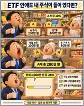
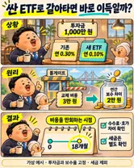
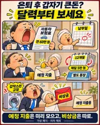
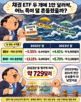
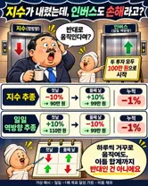

# ETF 만화 · 제작 인수인계

전체 **656장** · ETF 만화 256장 · TRUSTA 400장. 두 목록을 합산했습니다.

[프롬프트 펼쳐 보기](prompts.md) · [파일 목록 CSV](inventory.csv) · [캐릭터 참조](references/)

원본 PNG는 [Releases](https://github.com/geben147-create/etf-comics-handoff/releases/tag/originals)에서 두 묶음으로 받을 수 있습니다. 바둑판에서 카드를 클릭하면 확대용 이미지가 열립니다.

[공개 바둑판과 미디어 플레이어](https://geben147-create.github.io/etf-comics-handoff/)

## 바둑판

- [ETF 만화 1–50](gallery/numbered-01.md)
- [ETF 만화 51–100](gallery/numbered-02.md)
- [ETF 만화 101–150](gallery/numbered-03.md)
- [ETF 만화 151–200](gallery/numbered-04.md)
- [ETF 만화 201–250](gallery/numbered-05.md)
- [ETF 만화 251–256](gallery/numbered-06.md)
- [TRUSTA 카드 1–50](gallery/trusta-01.md)
- [TRUSTA 카드 51–100](gallery/trusta-02.md)
- [TRUSTA 카드 101–150](gallery/trusta-03.md)
- [TRUSTA 카드 151–200](gallery/trusta-04.md)
- [TRUSTA 카드 201–250](gallery/trusta-05.md)
- [TRUSTA 카드 251–300](gallery/trusta-06.md)
- [TRUSTA 카드 301–350](gallery/trusta-07.md)
- [TRUSTA 카드 351–400](gallery/trusta-08.md)

## 최근 카드

<table><tr><td valign="top"><a href="./numbered/256.webp"> ETF 안에도 내 주식이 들어 있다면?</a></td><td valign="top"><a href="./numbered/255.webp"> 싼 ETF로 갈아타면 바로 이득일까?</a></td><td valign="top"><a href="./numbered/254.webp"> 은퇴 후 갑자기 큰돈? 달력부터 보세요</a></td><td valign="top"><a href="./numbered/253.webp"> 채권 ETF 두 개에 1만 달러씩, 어느 쪽이 덜 흔들렸을까?</a></td><td valign="top"><a href="./numbered/252.webp"> 지수가 내렸는데, 인버스도 손해라고?</a></td></tr></table>
