# ETF 만화 · 1–50

[전체 목록](../README.md)

<table>
<tr><td valign="top"><a href="../numbered/256.webp">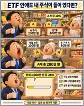 ETF 안에도 내 주식이 들어 있다면?</a></td><td valign="top"><a href="../numbered/255.webp">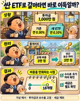 싼 ETF로 갈아타면 바로 이득일까?</a></td><td valign="top"><a href="../numbered/254.webp">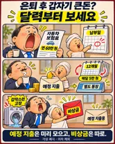 은퇴 후 갑자기 큰돈? 달력부터 보세요</a></td><td valign="top"><a href="../numbered/253.webp">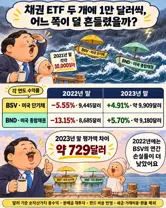 채권 ETF 두 개에 1만 달러씩, 어느 쪽이 덜 흔들렸을까?</a></td><td valign="top"><a href="../numbered/252.webp">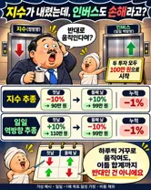 지수가 내렸는데, 인버스도 손해라고?</a></td></tr>
<tr><td valign="top"><a href="../numbered/251.webp">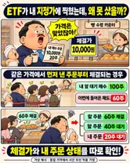 ETF가 내 지정가에 찍혔는데, 왜 못 샀을까?</a></td><td valign="top"><a href="../numbered/250.webp">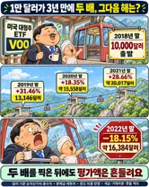 1만 달러가 3년 만에 두 배, 그다음 해는?</a></td><td valign="top"><a href="../numbered/249.webp">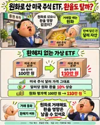 원화로 산 미국 주식 ETF, 환율도 탈까?</a></td><td valign="top"><a href="../numbered/248.webp">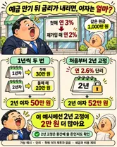 예금 만기 뒤 금리가 내리면, 이자는 얼마?</a></td><td valign="top"><a href="../numbered/247.webp">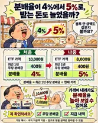 분배율이 4%에서 5%로, 받는 돈도 늘었을까?</a></td></tr>
<tr><td valign="top"><a href="../numbered/246.webp">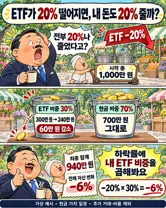 ETF가 20% 떨어지면, 내 돈도 20% 줄까?</a></td><td valign="top"><a href="../numbered/245.webp">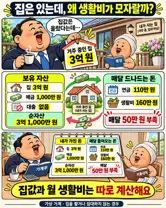 집은 있는데, 왜 생활비가 모자랄까?</a></td><td valign="top"><a href="../numbered/244.webp">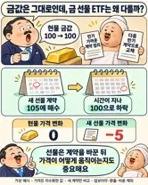 금값은 그대로인데, 금 선물 ETF는 왜 다를까?</a></td><td valign="top"><a href="../numbered/243.webp">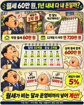 월세 60만 원, 1년 내내 다 내 돈일까?</a></td><td valign="top"><a href="../numbered/242.webp">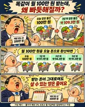 똑같이 월 100만 원 받는데, 왜 빠듯해질까?</a></td></tr>
<tr><td valign="top"><a href="../numbered/241.webp">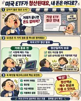 미국 ETF가 청산된대요, 내 돈은 어디로?</a></td><td valign="top"><a href="../numbered/240.webp">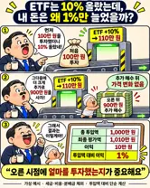 ETF는 10% 올랐는데, 내 돈은 왜 1%만 늘었을까?</a></td><td valign="top"><a href="../numbered/239.webp">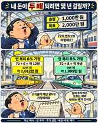 내 돈이 두 배 되려면 몇 년 걸릴까?</a></td><td valign="top"><a href="../numbered/238.webp">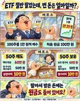 ETF 절반 팔았는데, 번 돈은 얼마일까?</a></td><td valign="top"><a href="../numbered/237.webp">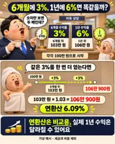 6개월에 3%, 1년에 6%면 똑같을까?</a></td></tr>
<tr><td valign="top"><a href="../numbered/236.webp">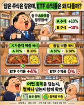 담은 주식은 같은데, ETF 수익률은 왜 다를까?</a></td><td valign="top"><a href="../numbered/235.webp">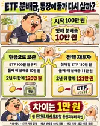 ETF 분배금, 통장에 둘까 다시 살까?</a></td><td valign="top"><a href="../numbered/234.webp">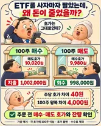 ETF를 사자마자 팔았는데, 왜 돈이 줄었을까?</a></td><td valign="top"><a href="../numbered/233.webp">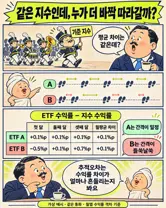 같은 지수인데, 누가 더 바짝 따라갈까?</a></td><td valign="top"><a href="../numbered/232.webp">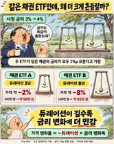 같은 채권 ETF인데, 왜 더 크게 흔들릴까?</a></td></tr>
<tr><td valign="top"><a href="../numbered/231.webp">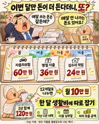 이번 달만 돈이 더 든다더니, 또?</a></td><td valign="top"><a href="../numbered/230.webp">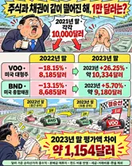 주식과 채권이 같이 떨어진 해, 1만 달러는?</a></td><td valign="top"><a href="../numbered/229.webp">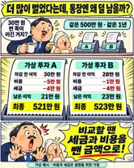 더 많이 벌었다는데, 통장엔 왜 덜 남을까?</a></td><td valign="top"><a href="../numbered/228.webp">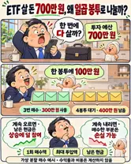 ETF 살 돈 700만 원, 왜 일곱 봉투로 나눌까?</a></td><td valign="top"><a href="../numbered/227.webp">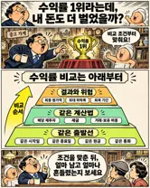 수익률 1위라는데, 내 돈도 더 벌었을까?</a></td></tr>
<tr><td valign="top"><a href="../numbered/226.webp">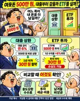 여윳돈 500만 원, 대출부터 갚을까 ETF를 살까?</a></td><td valign="top"><a href="../numbered/225.webp">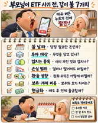 부모님이 ETF 사기 전, 같이 볼 7가지</a></td><td valign="top"><a href="../numbered/224.webp">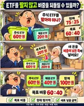 ETF를 팔지 않고 비중을 되돌릴 수 있을까?</a></td><td valign="top"><a href="../numbered/223.webp">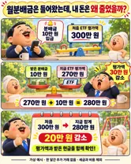 월분배금은 들어왔는데, 내 돈은 왜 줄었을까?</a></td><td valign="top"><a href="../numbered/222.webp">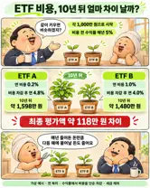 ETF 비용, 10년 뒤 얼마 차이 날까?</a></td></tr>
<tr><td valign="top"><a href="../numbered/221.webp">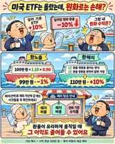 미국 ETF는 올랐는데, 원화로는 손해?</a></td><td valign="top"><a href="../numbered/220.webp">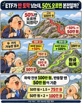 ETF가 반 토막 났는데, 50% 오르면 본전일까?</a></td><td valign="top"><a href="../numbered/219.webp">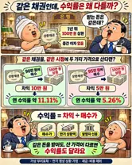 같은 채권인데, 수익률은 왜 다를까?</a></td><td valign="top"><a href="../numbered/218.webp">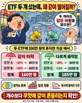 ETF 두 개 샀는데, 왜 같이 떨어질까?</a></td><td valign="top"><a href="../numbered/217.webp">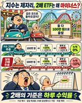 지수는 제자리, 2배 ETF는 왜 마이너스?</a></td></tr>
<tr><td valign="top"><a href="../numbered/216.webp">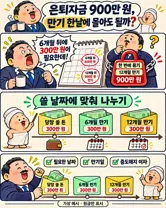 은퇴자금 900만 원, 만기 한날에 몰아도 될까?</a></td><td valign="top"><a href="../numbered/215.webp">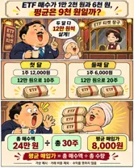 ETF 매수가 1만 2천 원과 6천 원, 평균은 9천 원일까?</a></td><td valign="top"><a href="../numbered/214.webp">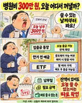 병원비 300만 원, 오늘 어디서 꺼낼까?</a></td><td valign="top"><a href="../numbered/213.webp">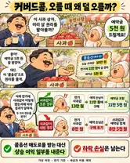 커버드콜, 오를 때 왜 덜 오를까?</a></td><td valign="top"><a href="../numbered/212.webp">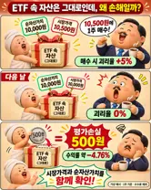 ETF 속 자산은 그대로인데, 왜 손해일까?</a></td></tr>
<tr><td valign="top"><a href="../numbered/211.webp">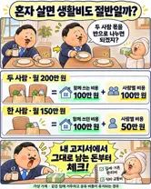 혼자 살면 생활비도 절반일까?</a></td><td valign="top"><a href="../numbered/210.webp">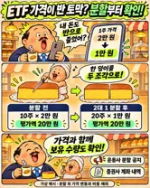 ETF 가격이 반 토막? 분할부터 확인!</a></td><td valign="top"><a href="../numbered/209.webp">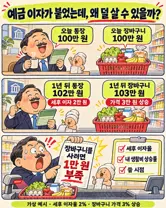 예금 이자가 붙었는데, 왜 덜 살 수 있을까?</a></td><td valign="top"><a href="../numbered/208.webp">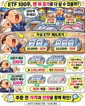 ETF 100주, 맨 위 호가로 다 살 수 있을까?</a></td><td valign="top"><a href="../numbered/207.webp">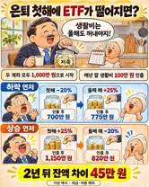 은퇴 첫해에 ETF가 떨어지면?</a></td></tr>
</table>
