# ETF 만화 · 51–100

[전체 목록](../README.md)

<table>
<tr><td valign="top"><a href="../numbered/206.webp">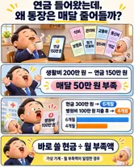 연금 들어왔는데, 왜 통장은 매달 줄어들까?</a></td><td valign="top"><a href="../numbered/205.webp">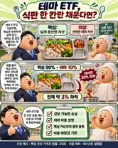 테마 ETF, 식판 한 칸만 채운다면?</a></td><td valign="top"><a href="../numbered/204.webp">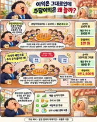 이익은 그대로인데 주당이익은 왜 늘까?</a></td><td valign="top"><a href="../numbered/203.webp">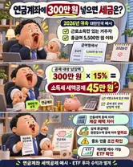 연금계좌에 300만 원 넣으면 세금은?</a></td><td valign="top"><a href="../numbered/202.webp">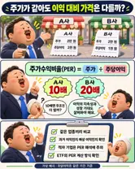 주가가 같아도 이익 대비 가격은 다를까?</a></td></tr>
<tr><td valign="top"><a href="../numbered/201.webp">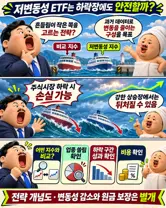 저변동성 ETF는 하락장에도 안전할까?</a></td><td valign="top"><a href="../numbered/200.webp">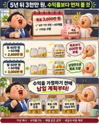 5년 뒤 3천만 원, 수익률보다 먼저 볼 것</a></td><td valign="top"><a href="../numbered/199.webp">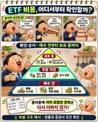 ETF 비용, 어디서부터 확인할까?</a></td><td valign="top"><a href="../numbered/198.webp">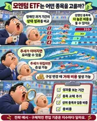 모멘텀 ETF는 어떤 종목을 고를까?</a></td><td valign="top"><a href="../numbered/197.webp">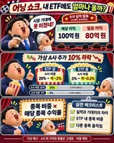 어닝 쇼크, 내 ETF에도 얼마나 올까?</a></td></tr>
<tr><td valign="top"><a href="../numbered/196.webp">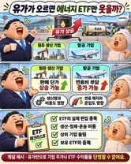 유가가 오르면 에너지 ETF만 웃을까?</a></td><td valign="top"><a href="../numbered/195.webp"> 같은 지수, ETF가 따라가는 방식은 다르다?</a></td><td valign="top"><a href="../numbered/194.webp">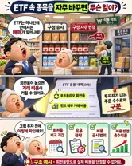 ETF 속 종목을 자주 바꾸면 무슨 일이?</a></td><td valign="top"><a href="../numbered/193.webp">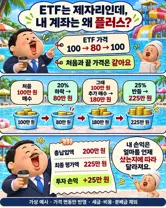 ETF는 제자리인데, 내 계좌는 왜 플러스?</a></td><td valign="top"><a href="../numbered/192.webp">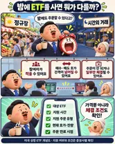 밤에 ETF를 사면 뭐가 다를까?</a></td></tr>
<tr><td valign="top"><a href="../numbered/191.webp">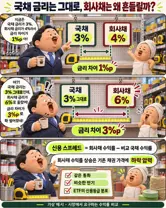 국채 금리는 그대로, 회사채는 왜 흔들릴까?</a></td><td valign="top"><a href="../numbered/190.webp">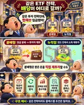 같은 ETF 전략, 배당이 어디로 갈까?</a></td><td valign="top"><a href="../numbered/189.webp">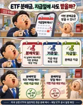 ETF 분배금, 지급일에 사도 받을까?</a></td><td valign="top"><a href="../numbered/188.webp">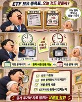 ETF 보유 종목표, 오늘 것도 맞을까?</a></td><td valign="top"><a href="../numbered/187.webp">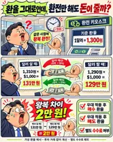 환율 그대로인데, 환전만 해도 돈이 줄까?</a></td></tr>
<tr><td valign="top"><a href="../numbered/186.webp">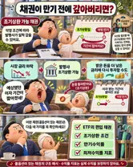 채권이 만기 전에 갚아버리면?</a></td><td valign="top"><a href="../numbered/185.webp">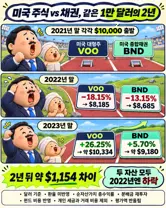 미국 주식 vs 채권, 같은 1만 달러의 2년</a></td><td valign="top"><a href="../numbered/184.webp">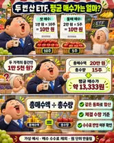 두 번 산 ETF, 평균 매수가는 얼마?</a></td><td valign="top"><a href="../numbered/183.webp">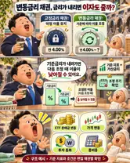 변동금리 채권, 금리가 내리면 이자도 줄까?</a></td><td valign="top"><a href="../numbered/182.webp">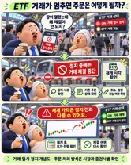 ETF 거래가 멈추면 주문은 어떻게 될까?</a></td></tr>
<tr><td valign="top"><a href="../numbered/181.webp">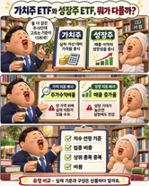 가치주 ETF와 성장주 ETF, 뭐가 다를까?</a></td><td valign="top"><a href="../numbered/180.webp">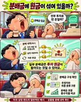 분배금에 원금이 섞여 있을까?</a></td><td valign="top"><a href="../numbered/179.webp">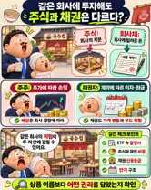 같은 회사에 투자해도 주식과 채권은 다르다?</a></td><td valign="top"><a href="../numbered/178.webp">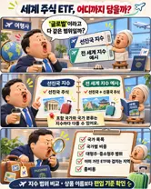 세계 주식 ETF, 어디까지 담을까?</a></td><td valign="top"><a href="../numbered/177.webp">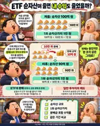 ETF 순자산이 줄면 내 수익도 줄었을까?</a></td></tr>
<tr><td valign="top"><a href="../numbered/176.webp">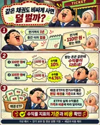 같은 채권도 비싸게 사면 덜 벌까?</a></td><td valign="top"><a href="../numbered/175.webp">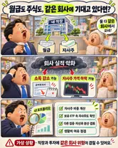 월급도 주식도, 같은 회사에 기대고 있다면?</a></td><td valign="top"><a href="../numbered/174.webp">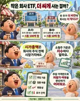 작은 회사 ETF, 더 싸게 사는 걸까?</a></td><td valign="top"><a href="../numbered/173.webp">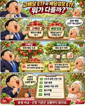 고배당 ETF와 배당성장 ETF, 뭐가 다를까?</a></td><td valign="top"><a href="../numbered/172.webp">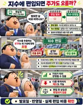 지수에 편입되면 주가도 오를까?</a></td></tr>
<tr><td valign="top"><a href="../numbered/171.webp">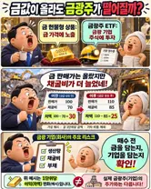 금값이 올라도 금광주가 떨어질까?</a></td><td valign="top"><a href="../numbered/170.webp">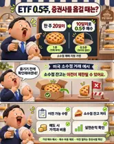 ETF 0.5주, 증권사를 옮길 때는?</a></td><td valign="top"><a href="../numbered/169.webp">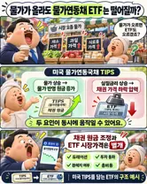 물가가 올라도 물가연동채 ETF는 떨어질까?</a></td><td valign="top"><a href="../numbered/168.webp">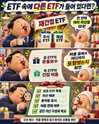 ETF 속에 다른 ETF가 들어 있다면?</a></td><td valign="top"><a href="../numbered/167.webp">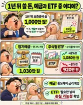 1년 뒤 쓸 돈, 예금과 ETF 중 어디에?</a></td></tr>
<tr><td valign="top"><a href="../numbered/166.webp">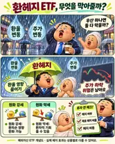 환헤지 ETF, 무엇을 막아줄까?</a></td><td valign="top"><a href="../numbered/165.webp">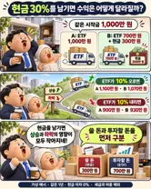 현금 30%를 남기면 수익은 어떻게 달라질까?</a></td><td valign="top"><a href="../numbered/164.webp">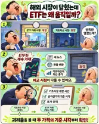 해외 시장이 닫혔는데 ETF는 왜 움직일까?</a></td><td valign="top"><a href="../numbered/163.webp">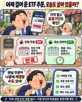 어제 걸어 둔 ETF 주문, 오늘도 살아 있을까?</a></td><td valign="top"><a href="../numbered/162.webp">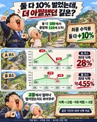 둘 다 10% 벌었는데, 더 아찔했던 길은?</a></td></tr>
<tr><td valign="top"><a href="../numbered/161.webp">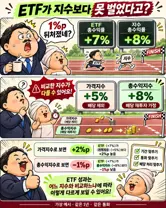 ETF가 지수보다 못 벌었다고?</a></td><td valign="top"><a href="../numbered/160.webp">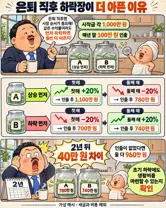 은퇴 직후 하락장이 더 아픈 이유</a></td><td valign="top"><a href="../numbered/159.webp">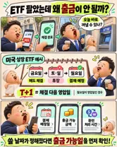 ETF 팔았는데 왜 출금이 안 될까?</a></td><td valign="top"><a href="../numbered/158.webp">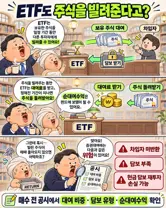 ETF도 주식을 빌려준다고?</a></td><td valign="top"><a href="../numbered/157.webp">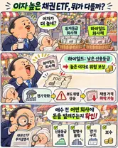 이자 높은 채권 ETF, 뭐가 다를까?</a></td></tr>
</table>
