# ETF 만화 · 101–150

[전체 목록](../README.md)

<table>
<tr><td valign="top"><a href="../numbered/156.webp">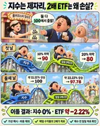 지수는 제자리, 2배 ETF는 왜 손실?</a></td><td valign="top"><a href="../numbered/155.webp">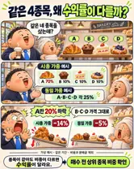 같은 4종목, 왜 수익률이 다를까?</a></td><td valign="top"><a href="../numbered/154.webp">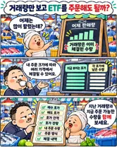 거래량만 보고 ETF를 주문해도 될까?</a></td><td valign="top"><a href="../numbered/153.webp">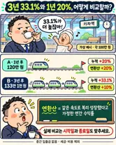 3년 33.1%와 1년 20%, 어떻게 비교할까?</a></td><td valign="top"><a href="../numbered/152.webp">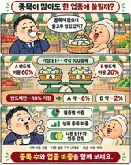 종목이 많아도 한 업종에 쏠릴까?</a></td></tr>
<tr><td valign="top"><a href="../numbered/151.webp">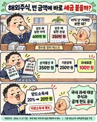 해외주식, 번 금액에 바로 세금 붙을까?</a></td><td valign="top"><a href="../numbered/150.webp">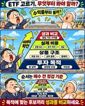 ETF 고르기, 무엇부터 봐야 할까?</a></td><td valign="top"><a href="../numbered/149.webp">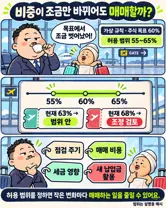 비중이 조금만 바뀌어도 매매할까?</a></td><td valign="top"><a href="../numbered/148.webp">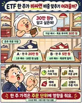 ETF 한 주가 비싸면 비중 맞추기 어려울까?</a></td><td valign="top"><a href="../numbered/147.webp">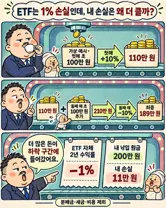 ETF는 1% 손실인데, 내 손실은 왜 더 클까?</a></td></tr>
<tr><td valign="top"><a href="../numbered/146.webp">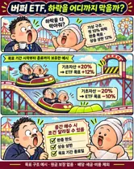 버퍼 ETF, 하락을 어디까지 막을까?</a></td><td valign="top"><a href="../numbered/145.webp">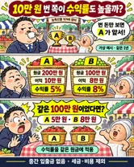 10만 원 번 쪽이 수익률도 높을까?</a></td><td valign="top"><a href="../numbered/144.webp">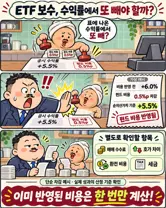 ETF 보수, 수익률에서 또 빼야 할까?</a></td><td valign="top"><a href="../numbered/143.webp">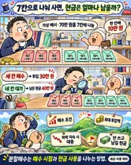 7칸으로 나눠 사면, 현금은 얼마나 남을까?</a></td><td valign="top"><a href="../numbered/142.webp">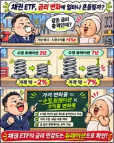 채권 ETF, 금리 변화에 얼마나 흔들릴까?</a></td></tr>
<tr><td valign="top"><a href="../numbered/141.webp">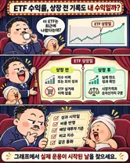 ETF 수익률, 상장 전 기록도 내 수익일까?</a></td><td valign="top"><a href="../numbered/140.webp">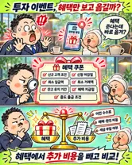 투자 이벤트, 혜택만 보고 옮길까?</a></td><td valign="top"><a href="../numbered/139.webp">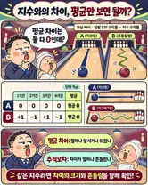 지수와의 차이, 평균만 보면 될까?</a></td><td valign="top"><a href="../numbered/138.webp">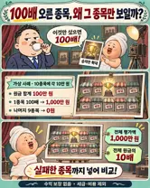 100배 오른 종목, 왜 그 종목만 보일까?</a></td><td valign="top"><a href="../numbered/137.webp">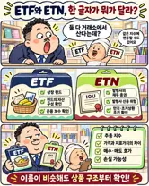 ETF와 ETN, 한 글자가 뭐가 달라?</a></td></tr>
<tr><td valign="top"><a href="../numbered/136.webp">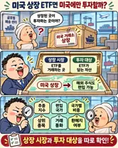 미국 상장 ETF면 미국에만 투자할까?</a></td><td valign="top"><a href="../numbered/135.webp">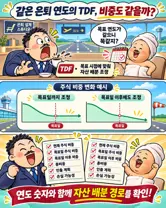 같은 은퇴 연도의 TDF, 비중도 같을까?</a></td><td valign="top"><a href="../numbered/134.webp">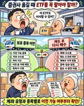 증권사 옮길 때 ETF를 꼭 팔아야 할까?</a></td><td valign="top"><a href="../numbered/133.webp">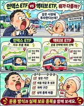 인덱스 ETF vs 액티브 ETF, 뭐가 다를까?</a></td><td valign="top"><a href="../numbered/132.webp">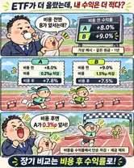 ETF가 더 올랐는데, 내 수익은 더 적다?</a></td></tr>
<tr><td valign="top"><a href="../numbered/131.webp">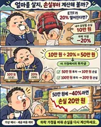 얼마를 살지, 손실부터 계산해 볼까?</a></td><td valign="top"><a href="../numbered/130.webp">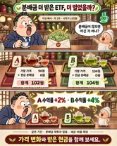 분배금 더 받은 ETF, 더 벌었을까?</a></td><td valign="top"><a href="../numbered/129.webp"> 채권 만기를 한날에 몰아도 될까?</a></td><td valign="top"><a href="../numbered/128.webp">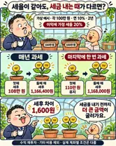 세율이 같아도, 세금 내는 때가 다르면?</a></td><td valign="top"><a href="../numbered/127.webp">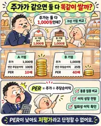 주가가 같으면 둘 다 똑같이 쌀까?</a></td></tr>
<tr><td valign="top"><a href="../numbered/126.webp">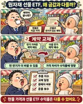 원자재 선물 ETF, 왜 금값과 다를까?</a></td><td valign="top"><a href="../numbered/125.webp">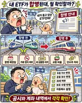 내 ETF가 합병된대, 뭘 확인할까?</a></td><td valign="top"><a href="../numbered/124.webp">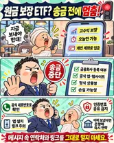 원금 보장 ETF? 송금 전에 멈춤!</a></td><td valign="top"><a href="../numbered/123.webp">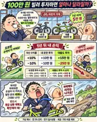 100만 원 빌려 투자하면 얼마나 달라질까?</a></td><td valign="top"><a href="../numbered/122.webp">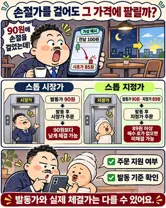 손절가를 걸어도 그 가격에 팔릴까?</a></td></tr>
<tr><td valign="top"><a href="../numbered/121.webp">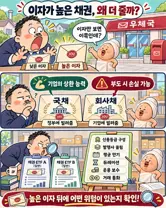 이자가 높은 채권, 왜 더 줄까?</a></td><td valign="top"><a href="../numbered/120.webp">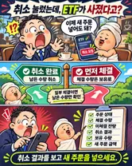 취소 눌렀는데, ETF가 사졌다고?</a></td><td valign="top"><a href="../numbered/119.webp">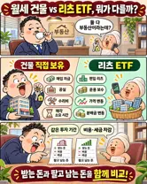 월세 건물 vs 리츠 ETF, 뭐가 다를까?</a></td><td valign="top"><a href="../numbered/118.webp">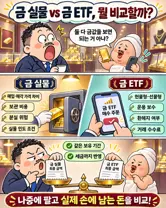 금 실물 vs 금 ETF, 뭘 비교할까?</a></td><td valign="top"><a href="../numbered/117.webp">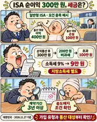 ISA 순이익 300만 원, 세금은?</a></td></tr>
<tr><td valign="top"><a href="../numbered/116.webp"> 미국 주식 2배까지, 순탄했을까?</a></td><td valign="top"><a href="../numbered/115.webp">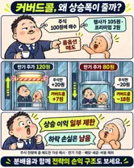 커버드콜, 왜 상승폭이 줄까?</a></td><td valign="top"><a href="../numbered/114.webp">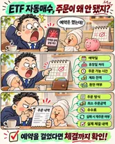 ETF 자동매수, 주문이 왜 안 됐지?</a></td><td valign="top"><a href="../numbered/113.webp">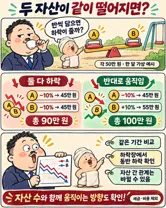 두 자산이 같이 떨어지면?</a></td><td valign="top"><a href="../numbered/112.webp">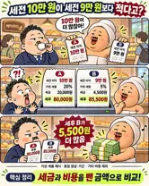 세전 10만 원이 세전 9만 원보다 적다고?</a></td></tr>
<tr><td valign="top"><a href="../numbered/111.webp">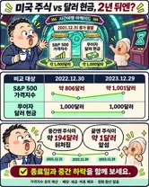 미국 주식 vs 달러 현금, 2년 뒤엔?</a></td><td valign="top"><a href="../numbered/110.webp">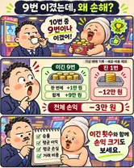 9번 이겼는데, 왜 손해?</a></td><td valign="top"><a href="../numbered/109.webp">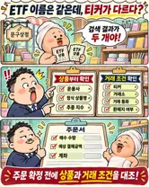 ETF 이름은 같은데, 티커가 다르다?</a></td><td valign="top"><a href="../numbered/108.webp">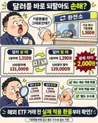 달러를 바로 되팔아도 손해?</a></td><td valign="top"><a href="../numbered/107.webp">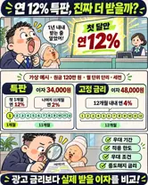 연 12% 특판, 진짜 더 받을까?</a></td></tr>
</table>
