# ETF 만화 · 151–200

[전체 목록](../README.md)

<table>
<tr><td valign="top"><a href="../numbered/106.webp">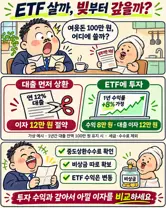 ETF 살까, 빚부터 갚을까?</a></td><td valign="top"><a href="../numbered/105.webp">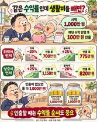 같은 수익률인데 생활비를 빼면?</a></td><td valign="top"><a href="../numbered/104.webp">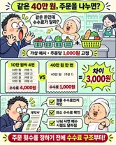 같은 40만 원, 주문을 나누면?</a></td><td valign="top"><a href="../numbered/103.webp">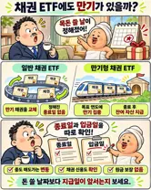 채권 ETF에도 만기가 있을까?</a></td><td valign="top"><a href="../numbered/102.webp">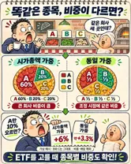 똑같은 종목, 비중이 다르면?</a></td></tr>
<tr><td valign="top"><a href="../numbered/101.webp"> ETF 팔면 그날 돈을 쓸 수 있을까?</a></td><td valign="top"><a href="../numbered/100.webp">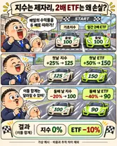 지수는 제자리, 2배 ETF는 왜 손실?</a></td><td valign="top"><a href="../numbered/099.webp">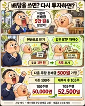 ETF 분배금을 쓰면? 다시 투자하면?</a></td><td valign="top"><a href="../numbered/098.webp">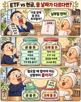 ETF vs 현금, 쓸 날짜가 다르다면?</a></td><td valign="top"><a href="../numbered/097.webp">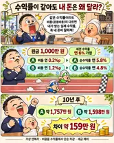 비용이 다르면 10년 후 내 돈은?</a></td></tr>
<tr><td valign="top"><a href="../numbered/096.webp">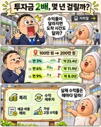 투자금 2배, 몇 년 걸릴까?</a></td><td valign="top"><a href="../numbered/095.webp">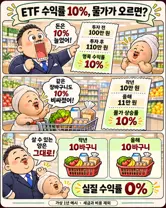 ETF 수익률 10%, 물가가 오르면?</a></td><td valign="top"><a href="../numbered/094.webp">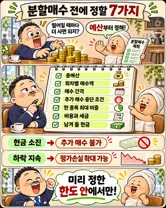 분할매수 전에 정할 7가지</a></td><td valign="top"><a href="../numbered/093.webp">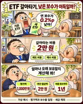 ETF 갈아타기, 낮은 보수가 이득일까?</a></td><td valign="top"><a href="../numbered/092.webp">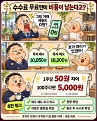 수수료 무료인데 비용이 남는다고?</a></td></tr>
<tr><td valign="top"><a href="../numbered/091.webp">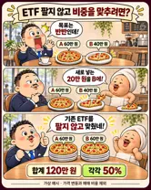 ETF 팔지 않고 비중을 맞추려면?</a></td><td valign="top"><a href="../numbered/090.webp">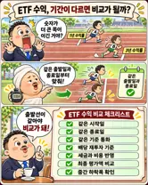 ETF 수익, 기간이 다르면 비교가 될까?</a></td><td valign="top"><a href="../numbered/089.webp"> 월분배 ETF 보기 전 체크 7가지</a></td><td valign="top"><a href="../numbered/088.webp">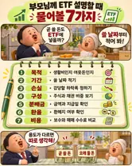 부모님께 ETF 설명할 때 물어볼 7가지</a></td><td valign="top"><a href="../numbered/087.webp">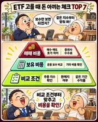 ETF 고를 때 돈 아끼는 체크 TOP 7</a></td></tr>
<tr><td valign="top"><a href="../numbered/086.webp">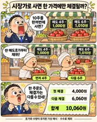 시장가로 사면 한 가격에만 체결될까?</a></td><td valign="top"><a href="../numbered/085.webp">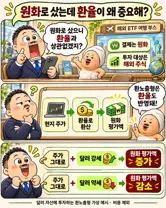 원화로 샀는데 환율이 왜 중요해?</a></td><td valign="top"><a href="../numbered/084.webp"> 금리가 오르면 채권 ETF는?</a></td><td valign="top"><a href="../numbered/083.webp">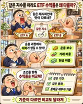 같은 지수를 따라도 ETF 수익률은 왜 다를까?</a></td><td valign="top"><a href="../numbered/082.webp">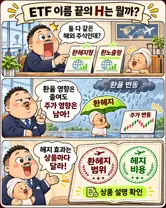 ETF 이름 끝의 H는 뭘까?</a></td></tr>
<tr><td valign="top"><a href="../numbered/081.webp">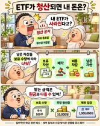 ETF가 청산되면 내 돈은?</a></td><td valign="top"><a href="../numbered/080.webp">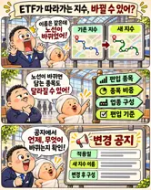 ETF가 따라가는 지수, 바뀔 수 있어?</a></td><td valign="top"><a href="../numbered/079.webp">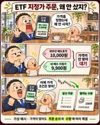 ETF 지정가 주문, 왜 안 샀지?</a></td><td valign="top"><a href="../numbered/078.webp">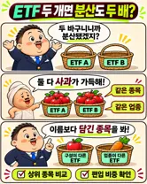 ETF 두 개면 분산도 두 배?</a></td><td valign="top"><a href="../numbered/077.webp">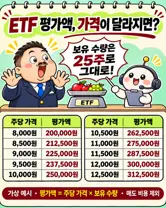 ETF 평가액, 가격이 달라지면?</a></td></tr>
<tr><td valign="top"><a href="../numbered/076.webp">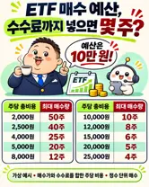 ETF 매수 예산, 수수료까지 넣으면 몇 주?</a></td><td valign="top"><a href="../numbered/075.webp">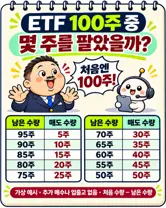 ETF 100주 중 몇 주를 팔았을까?</a></td><td valign="top"><a href="../numbered/074.webp">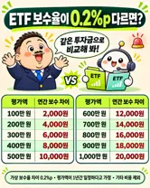 ETF 보수율이 0.2%p 다르면?</a></td><td valign="top"><a href="../numbered/073.webp">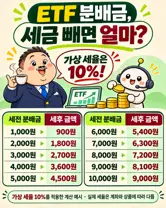 ETF 분배금, 세금 빼면 얼마?</a></td><td valign="top"><a href="../numbered/072.webp">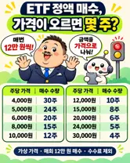 ETF 정액 매수, 가격이 오르면 몇 주?</a></td></tr>
<tr><td valign="top"><a href="../numbered/071.webp">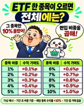 ETF 한 종목이 오르면 전체에는?</a></td><td valign="top"><a href="../numbered/070.webp">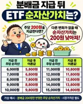 분배금 지급 뒤 ETF 순자산가치는?</a></td><td valign="top"><a href="../numbered/069.webp">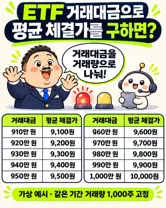 ETF 거래대금으로 평균 체결가를 구하면?</a></td><td valign="top"><a href="../numbered/068.webp">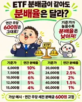 ETF 분배금이 같아도 분배율은 달라?</a></td><td valign="top"><a href="../numbered/067.webp">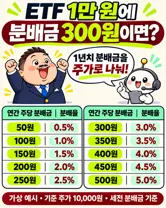 ETF 1만 원에 연간 분배금 300원이면?</a></td></tr>
<tr><td valign="top"><a href="../numbered/066.webp">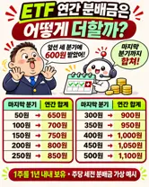 ETF 연간 분배금은 어떻게 더할까?</a></td><td valign="top"><a href="../numbered/065.webp">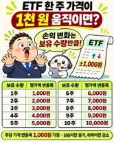 ETF 한 주 가격이 1천 원 움직이면?</a></td><td valign="top"><a href="../numbered/064.webp">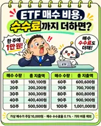 ETF 매수 비용, 수수료까지 더하면?</a></td><td valign="top"><a href="../numbered/063.webp">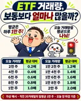 ETF 거래량, 보통보다 얼마나 많을까?</a></td><td valign="top"><a href="../numbered/062.webp">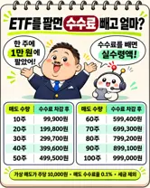 ETF를 팔면 수수료 빼고 얼마?</a></td></tr>
<tr><td valign="top"><a href="../numbered/061.webp">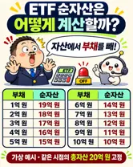 ETF 순자산은 어떻게 계산할까?</a></td><td valign="top"><a href="../numbered/060.webp">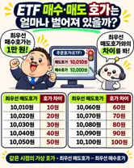 ETF 매수·매도 호가는 얼마나 벌어져 있을까?</a></td><td valign="top"><a href="../numbered/059.webp">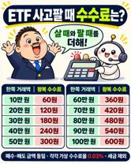 ETF 사고팔 때 수수료는?</a></td><td valign="top"><a href="../numbered/058.webp">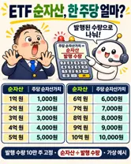 ETF 순자산, 한 주당 얼마?</a></td><td valign="top"><a href="../numbered/057.webp">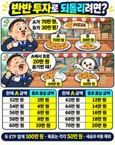 두 ETF를 다시 반반으로 맞추려면?</a></td></tr>
</table>
