# ETF 만화 · 201–250

[전체 목록](../README.md)

<table>
<tr><td valign="top"><a href="../numbered/056.webp">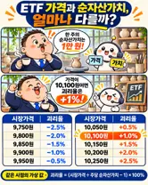 ETF 가격과 순자산가치, 얼마나 다를까?</a></td><td valign="top"><a href="../numbered/055.webp">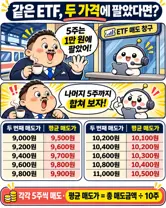 같은 ETF를 두 가격에 팔았다면 평균 매도가는?</a></td><td valign="top"><a href="../numbered/054.webp">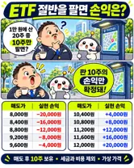 ETF 절반을 팔면 실현 손익은?</a></td><td valign="top"><a href="../numbered/053.webp">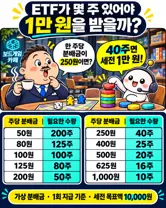 세전 분배금 1만 원을 받으려면 ETF가 몇 주 필요할까?</a></td><td valign="top"><a href="../numbered/052.webp">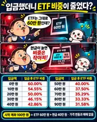 입금했더니 ETF 비중이 줄었다?</a></td></tr>
<tr><td valign="top"><a href="../numbered/051.webp">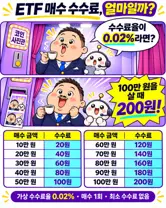 ETF 매수 수수료, 얼마일까?</a></td><td valign="top"><a href="../numbered/050.webp">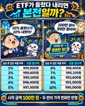 ETF가 같은 비율로 올랐다 내리면 본전일까?</a></td><td valign="top"><a href="../numbered/049.webp"> ETF를 두 번에 나눠 다른 수량으로 샀다면?</a></td><td valign="top"><a href="../numbered/048.webp">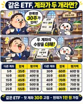 같은 ETF를 두 계좌에 보유하면 총평가액은?</a></td><td valign="top"><a href="../numbered/047.webp">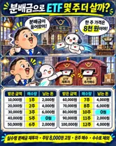 분배금으로 ETF 몇 주 더 살까?</a></td></tr>
<tr><td valign="top"><a href="../numbered/046.webp">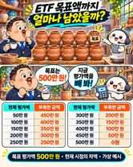 ETF 목표액까지 얼마나 남았을까?</a></td><td valign="top"><a href="../numbered/045.webp">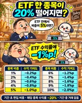 ETF에 담긴 한 종목이 20% 떨어지면?</a></td><td valign="top"><a href="../numbered/044.webp">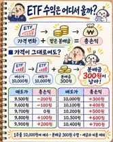 ETF 수익은 어디서 올까?</a></td><td valign="top"><a href="../numbered/043.webp">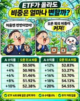 두 ETF 중 하나만 오르면 투자 비중은 어떻게 변할까?</a></td><td valign="top"><a href="../numbered/042.webp">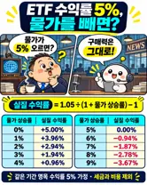 ETF 수익률 5%, 물가를 반영하면?</a></td></tr>
<tr><td valign="top"><a href="../numbered/041.webp">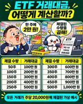 ETF 거래대금, 어떻게 계산할까?</a></td><td valign="top"><a href="../numbered/040.webp">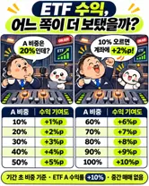 ETF가 10% 오르면 계좌 수익률에 얼마나 기여할까?</a></td><td valign="top"><a href="../numbered/039.webp">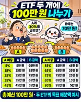 ETF 두 개에 100만 원 나누기</a></td><td valign="top"><a href="../numbered/038.webp">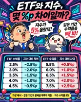 ETF와 지수의 수익률은 몇 %p 차이일까?</a></td><td valign="top"><a href="../numbered/037.webp">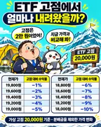 ETF 고점에서 얼마나 내려왔을까?</a></td></tr>
<tr><td valign="top"><a href="../numbered/036.webp">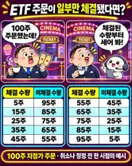 ETF 주문이 일부만 체결됐다면?</a></td><td valign="top"><a href="../numbered/035.webp">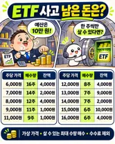 10만 원으로 ETF를 사고 남는 돈은?</a></td><td valign="top"><a href="../numbered/034.webp">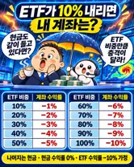 ETF가 10% 내리면 내 계좌는?</a></td><td valign="top"><a href="../numbered/033.webp">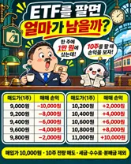 ETF 10주를 팔면 매매 손익은?</a></td><td valign="top"><a href="../numbered/032.webp">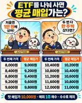 ETF를 나눠 사면 평균 매입가는?</a></td></tr>
<tr><td valign="top"><a href="../numbered/031.webp">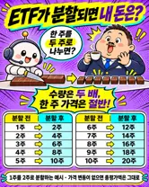 ETF가 분할되면 내 돈은?</a></td><td valign="top"><a href="../numbered/030.webp">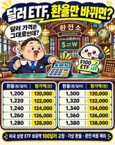 미국 상장 ETF 100달러, 환율에 따라 원화 평가액은?</a></td><td valign="top"><a href="../numbered/029.webp">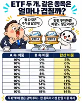 두 ETF에 반반 투자하면 한 종목의 비중은?</a></td><td valign="top"><a href="../numbered/028.webp">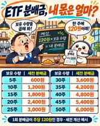 ETF 분배금, 내 몫은 얼마?</a></td><td valign="top"><a href="../numbered/027.webp">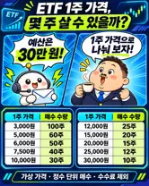 ETF 1주 가격, 몇 주 살 수 있을까?</a></td></tr>
<tr><td valign="top"><a href="../numbered/026.webp">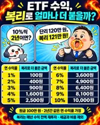 ETF 수익, 복리로 얼마나 더 붙을까?</a></td><td valign="top"><a href="../numbered/025.webp">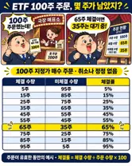 ETF 100주 주문, 몇 주가 남았지?</a></td><td valign="top"><a href="../numbered/024.webp">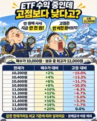 ETF 수익 중인데 고점보다 낮다고?</a></td><td valign="top"><a href="../numbered/023.webp">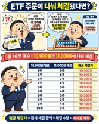 ETF 주문이 나눠 체결됐다면?</a></td><td valign="top"><a href="../numbered/022.webp">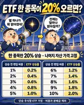 ETF 속 한 종목이 20% 오르면?</a></td></tr>
<tr><td valign="top"><a href="../numbered/021.webp">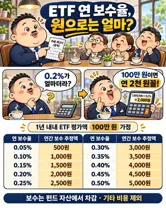 ETF 연 보수율, 원으로는 얼마?</a></td><td valign="top"><a href="../numbered/020.webp">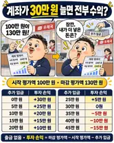 계좌가 30만 원 늘면 전부 수익?</a></td><td valign="top"><a href="../numbered/019.webp">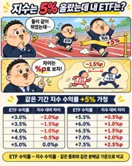 지수는 5% 올랐는데 내 ETF는?</a></td><td valign="top"><a href="../numbered/018.webp">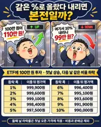 같은 비율로 올랐다 내리면 본전일까?</a></td><td valign="top"><a href="../numbered/017.webp">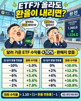 ETF가 올라도 환율이 내리면?</a></td></tr>
<tr><td valign="top"><a href="../numbered/016.webp">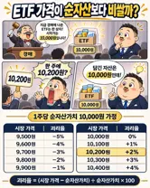 ETF 가격이 순자산보다 비쌀까?</a></td><td valign="top"><a href="../numbered/015.webp">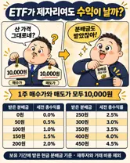 ETF가 제자리여도 수익이 날까?</a></td><td valign="top"><a href="../numbered/014.webp">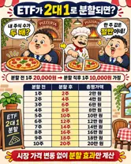 ETF가 2대 1로 분할되면?</a></td><td valign="top"><a href="../numbered/013.webp">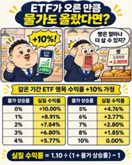 ETF가 오른 만큼 물가도 올랐다면?</a></td><td valign="top"><a href="../numbered/012.webp">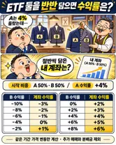 ETF 둘을 반반 담으면 수익률은?</a></td></tr>
<tr><td valign="top"><a href="../numbered/011.webp">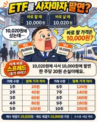 ETF를 사자마자 팔면?</a></td><td valign="top"><a href="../numbered/010.webp">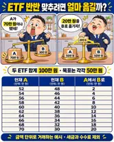 ETF 반반 맞추려면 얼마 옮길까?</a></td><td valign="top"><a href="../numbered/009.webp">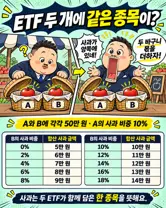 ETF 두 개에 같은 종목이?</a></td><td valign="top"><a href="../numbered/008.webp">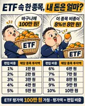 ETF 속 한 종목, 내 돈은 얼마?</a></td><td valign="top"><a href="../numbered/007.webp">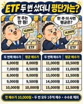 ETF 두 번 샀더니 평단가는?</a></td></tr>
</table>
