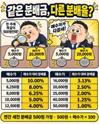
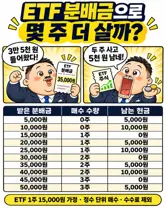
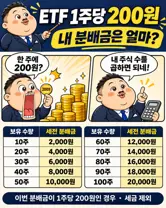
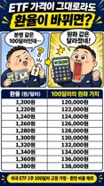
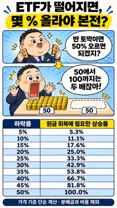
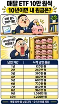

# ETF 만화 · 251–256

[전체 목록](../README.md)

<table>
<tr><td valign="top"><a href="../numbered/006.webp"> 같은 분배금, 다른 분배율?</a></td><td valign="top"><a href="../numbered/005.webp"> ETF 분배금으로 몇 주 더 살까?</a></td><td valign="top"><a href="../numbered/004.webp"> ETF 1주당 200원, 내 분배금은 얼마?</a></td><td valign="top"><a href="../numbered/003.webp"> ETF 가격이 그대로라도 환율이 바뀌면?</a></td><td valign="top"><a href="../numbered/002.webp"> 제목 미등록</a></td></tr>
<tr><td valign="top"><a href="../numbered/001.webp"> 제목 미등록</a></td></tr>
</table>
