# TRUSTA 카드 · 1–50

[전체 목록](../README.md)

<table>
<tr><td valign="top"><a href="../trusta/001.webp">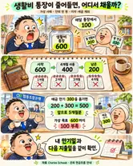 생활비 통장이 줄어들면, 어디서 채울까?</a></td><td valign="top"><a href="../trusta/002.webp">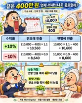 같은 400만 원, 언제 꺼내느냐도 중요할까?</a></td><td valign="top"><a href="../trusta/003.webp">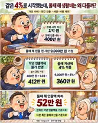 같은 4%로 시작했는데, 둘째 해 생활비는 왜 다를까?</a></td><td valign="top"><a href="../trusta/004.webp">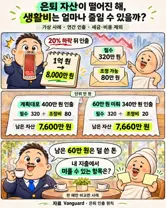 은퇴 자산이 떨어진 해, 생활비는 얼마나 줄일 수 있을까?</a></td><td valign="top"><a href="../trusta/005.webp"> 부모님 ETF, 주문 전 꼭 보는 7가지</a></td></tr>
<tr><td valign="top"><a href="../trusta/006.webp">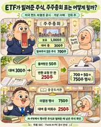 ETF가 빌려준 주식, 주주총회 표는 어떻게 될까?</a></td><td valign="top"><a href="../trusta/007.webp">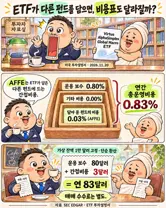 ETF가 다른 펀드를 담으면, 비용표도 달라질까?</a></td><td valign="top"><a href="../trusta/008.webp">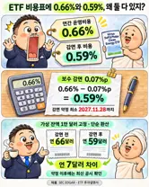 ETF 비용표에 0.66%와 0.59%, 왜 둘 다 있지?</a></td><td valign="top"><a href="../trusta/009.webp">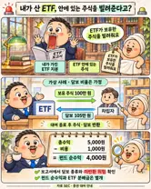 내가 산 ETF, 안에 있는 주식을 빌려준다고?</a></td><td valign="top"><a href="../trusta/010.webp">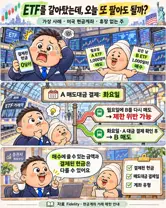 ETF를 갈아탔는데, 오늘 또 팔아도 될까?</a></td></tr>
<tr><td valign="top"><a href="../trusta/011.webp">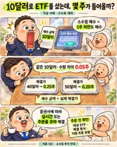 10달러로 ETF를 샀는데, 몇 주가 들어올까?</a></td><td valign="top"><a href="../trusta/012.webp">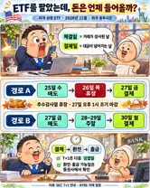 ETF를 팔았는데, 돈은 언제 들어올까?</a></td><td valign="top"><a href="../trusta/013.webp">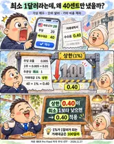 최소 1달러라는데, 왜 40센트만 냈을까?</a></td><td valign="top"><a href="../trusta/014.webp">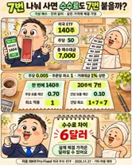 7번 나눠 사면 수수료도 7번 붙을까?</a></td><td valign="top"><a href="../trusta/015.webp">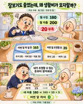 장보기도 줄였는데, 왜 생활비가 모자랄까?</a></td></tr>
<tr><td valign="top"><a href="../trusta/016.webp">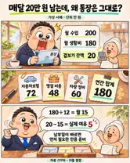 매달 20만 원 남는데, 왜 통장은 그대로?</a></td><td valign="top"><a href="../trusta/017.webp">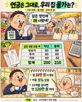 연금은 그대로, 우리 집 물가는?</a></td><td valign="top"><a href="../trusta/018.webp">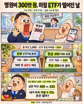 병원비 300만 원, 하필 ETF가 떨어진 날</a></td><td valign="top"><a href="../trusta/019.webp">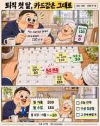 퇴직 첫 달, 카드값은 그대로</a></td><td valign="top"><a href="../trusta/020.webp">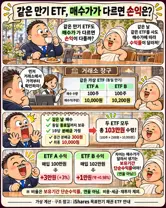 같은 만기 다른 매수가</a></td></tr>
<tr><td valign="top"><a href="../trusta/021.webp">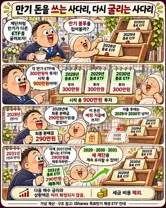 만기 사다리와 재투자</a></td><td valign="top"><a href="../trusta/022.webp">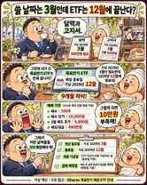 현금 필요일과 종료일</a></td><td valign="top"><a href="../trusta/023.webp">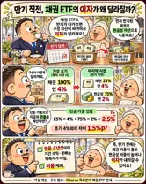 종료전 현금성 비중</a></td><td valign="top"><a href="../trusta/024.webp">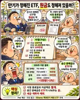 만기와 최종분배금</a></td><td valign="top"><a href="../trusta/025.webp">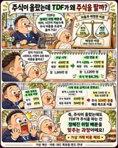 예정 배분과 리밸런싱</a></td></tr>
<tr><td valign="top"><a href="../trusta/026.webp">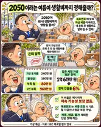 목표연도와 첫해 생활비</a></td><td valign="top"><a href="../trusta/027.webp">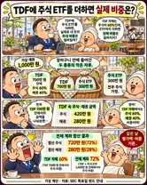 TDF와 주식ETF 합산</a></td><td valign="top"><a href="../trusta/028.webp">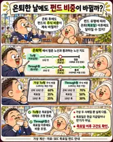 목표일 전후 배분 경로</a></td><td valign="top"><a href="../trusta/029.webp">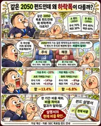 같은 목표연도 다른 하락폭</a></td><td valign="top"><a href="../trusta/030.webp">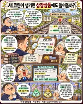 포크 에어드롭과 NAV</a></td></tr>
<tr><td valign="top"><a href="../trusta/031.webp">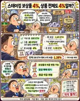 스테이킹과 상품 전체</a></td><td valign="top"><a href="../trusta/032.webp">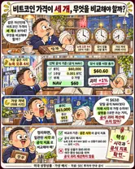 같은 시각 괴리율</a></td><td valign="top"><a href="../trusta/033.webp">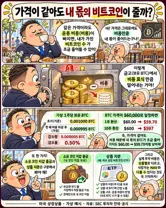 보수와 주당 BTC</a></td><td valign="top"><a href="../trusta/034.webp">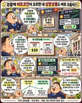 주말 코인과 거래시간</a></td><td valign="top"><a href="../trusta/035.webp">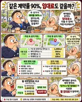 계약면적과 임대단가</a></td></tr>
<tr><td valign="top"><a href="../trusta/036.webp">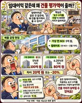 캡레이트와 건물가치</a></td><td valign="top"><a href="../trusta/037.webp">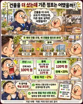 전체와 동일자산 NOI</a></td><td valign="top"><a href="../trusta/038.webp">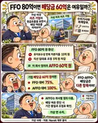 AFFO와 배당금</a></td><td valign="top"><a href="../trusta/039.webp">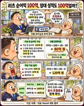 순이익과 FFO</a></td><td valign="top"><a href="../trusta/040.webp">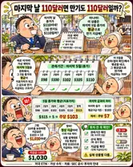 ETN 만기 평균 산식</a></td></tr>
<tr><td valign="top"><a href="../trusta/041.webp">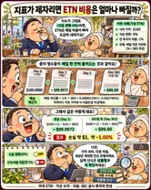 ETN 하루씩 차감되는 비용</a></td><td valign="top"><a href="../trusta/042.webp">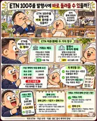 ETN 투자자 환매 최소단위</a></td><td valign="top"><a href="../trusta/043.webp">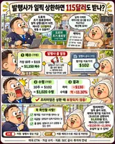 ETN 발행사 조기상환</a></td><td valign="top"><a href="../trusta/044.webp">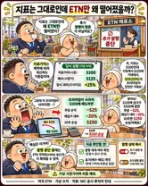 ETN 발행중단과 프리미엄</a></td><td valign="top"><a href="../trusta/045.webp">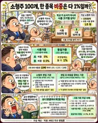 소형주 편입과 비중</a></td></tr>
<tr><td valign="top"><a href="../trusta/046.webp">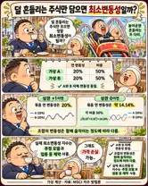 최소변동성과 조합</a></td><td valign="top"><a href="../trusta/047.webp">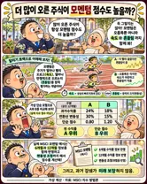 모멘텀과 변동성 조정</a></td><td valign="top"><a href="../trusta/048.webp">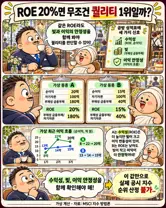 퀄리티와 재무 세 요소</a></td><td valign="top"><a href="../trusta/049.webp">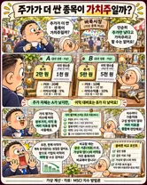 가치주와 주가표</a></td><td valign="top"><a href="../trusta/050.webp">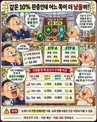 버퍼 상한과 비용 VS</a></td></tr>
</table>
