# TRUSTA 카드 · 51–100

[전체 목록](../README.md)

<table>
<tr><td valign="top"><a href="../trusta/051.webp">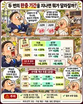 두 기간 버퍼 누적</a></td><td valign="top"><a href="../trusta/052.webp">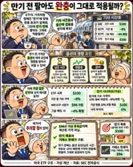 버퍼 중간 매도</a></td><td valign="top"><a href="../trusta/053.webp">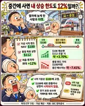 버퍼 중간 매수</a></td><td valign="top"><a href="../trusta/054.webp">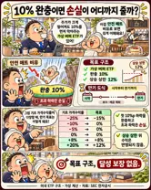 버퍼 만기 손익</a></td><td valign="top"><a href="../trusta/055.webp">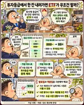 신용등급 강등과 ETF</a></td></tr>
<tr><td valign="top"><a href="../trusta/056.webp">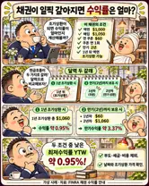 조기상환과 최저수익률</a></td><td valign="top"><a href="../trusta/057.webp">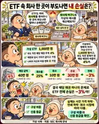 부도 한 곳의 ETF 영향</a></td><td valign="top"><a href="../trusta/058.webp">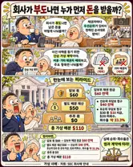 변제 순서 피라미드</a></td><td valign="top"><a href="../trusta/059.webp">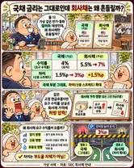 국채와 회사채 수익률차</a></td><td valign="top"><a href="../trusta/060.webp">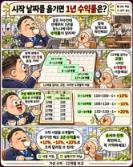 이동 12개월 수익률</a></td></tr>
<tr><td valign="top"><a href="../trusta/061.webp">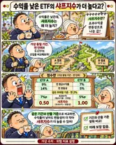 위험대비 샤프지수</a></td><td valign="top"><a href="../trusta/062.webp">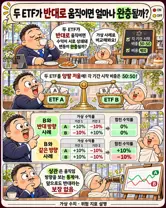 같이 움직이는 ETF</a></td><td valign="top"><a href="../trusta/063.webp">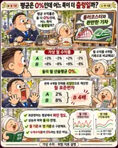 월 표준편차 비교</a></td><td valign="top"><a href="../trusta/064.webp">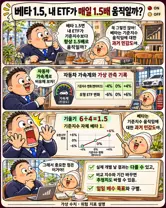 베타와 일일배수</a></td><td valign="top"><a href="../trusta/065.webp">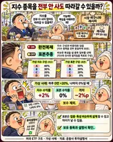 표본추종과 완전복제</a></td></tr>
<tr><td valign="top"><a href="../trusta/066.webp">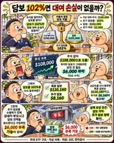 증권대여 담보 부족</a></td><td valign="top"><a href="../trusta/067.webp">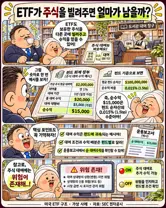 ETF 증권대여 순수익</a></td><td valign="top"><a href="../trusta/068.webp">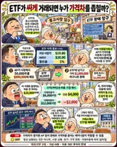 ETF 할인과 환매</a></td><td valign="top"><a href="../trusta/069.webp">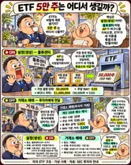 ETF 설정 단위</a></td><td valign="top"><a href="../trusta/070.webp">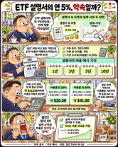 설명서 비용 비교 가정</a></td></tr>
<tr><td valign="top"><a href="../trusta/071.webp">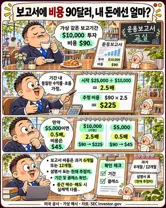 운용보고서 비용 환산</a></td><td valign="top"><a href="../trusta/072.webp">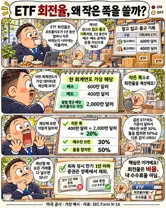 ETF 회전율 산식</a></td><td valign="top"><a href="../trusta/073.webp">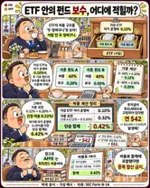 취득펀드 비용</a></td><td valign="top"><a href="../trusta/074.webp">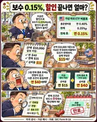 보수 면제 만료</a></td><td valign="top"><a href="../trusta/075.webp">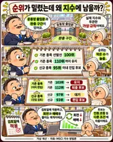 편입과 퇴출 완충구간</a></td></tr>
<tr><td valign="top"><a href="../trusta/076.webp">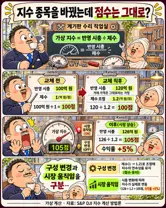 종목 교체와 제수</a></td><td valign="top"><a href="../trusta/077.webp">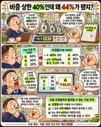 비중 상한과 조정일</a></td><td valign="top"><a href="../trusta/078.webp">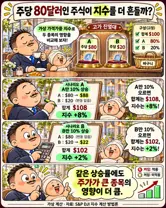 가격가중 영향</a></td><td valign="top"><a href="../trusta/079.webp">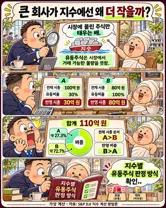 유동주식과 지수 비중</a></td><td valign="top"><a href="../trusta/080.webp">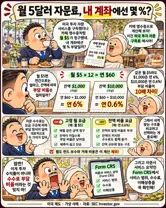 월 자문료와 잔액</a></td></tr>
<tr><td valign="top"><a href="../trusta/081.webp">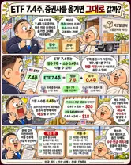 소수점 ETF와 계좌이전</a></td><td valign="top"><a href="../trusta/082.webp">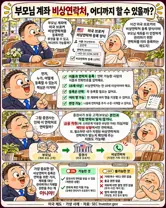 부모님 계좌 비상연락처</a></td><td valign="top"><a href="../trusta/083.webp">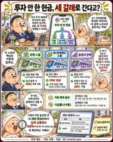 대기현금 세 갈래</a></td><td valign="top"><a href="../trusta/084.webp">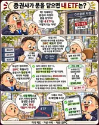 증권사 청산과 SIPC</a></td><td valign="top"><a href="../trusta/085.webp">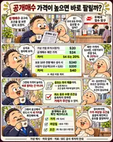 공개매수 응모</a></td></tr>
<tr><td valign="top"><a href="../trusta/086.webp">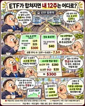 ETF 합병 교환</a></td><td valign="top"><a href="../trusta/087.webp">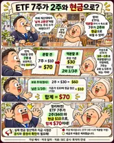 소수점 현금 정산</a></td><td valign="top"><a href="../trusta/088.webp">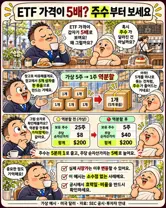 ETF 역분할</a></td><td valign="top"><a href="../trusta/089.webp">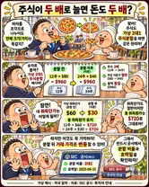 주식분할</a></td><td valign="top"><a href="../trusta/090.webp">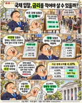 국채 경쟁 비경쟁 입찰</a></td></tr>
<tr><td valign="top"><a href="../trusta/091.webp">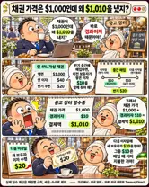 경과이자와 결제액</a></td><td valign="top"><a href="../trusta/092.webp">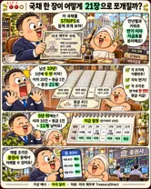 국채 지급권 분리</a></td><td valign="top"><a href="../trusta/093.webp">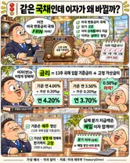 변동금리 국채</a></td><td valign="top"><a href="../trusta/094.webp"> 물가연동국채 원금과 이자</a></td><td valign="top"><a href="../trusta/095.webp">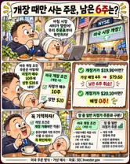 개장 조건 지정가</a></td></tr>
<tr><td valign="top"><a href="../trusta/096.webp">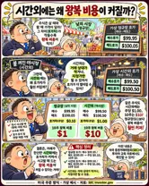 시간외 호가차</a></td><td valign="top"><a href="../trusta/097.webp">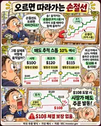 추적 스톱</a></td><td valign="top"><a href="../trusta/098.webp">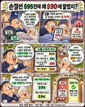 손절 가격과 급락</a></td><td valign="top"><a href="../trusta/099.webp">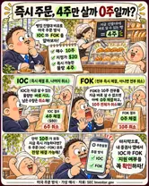 즉시 체결 조건</a></td><td valign="top"><a href="../trusta/100.webp">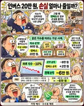 인버스 손실 상쇄</a></td></tr>
</table>
