# TRUSTA 카드 · 101–150

[전체 목록](../README.md)

<table>
<tr><td valign="top"><a href="../trusta/101.webp">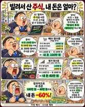 빌려서 산 주식</a></td><td valign="top"><a href="../trusta/102.webp">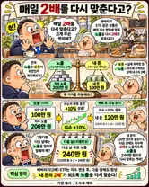 매일 배수 재설정</a></td><td valign="top"><a href="../trusta/103.webp">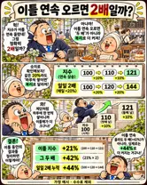 이틀 연속 상승</a></td><td valign="top"><a href="../trusta/104.webp">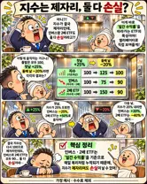 지수는 제자리</a></td><td valign="top"><a href="../trusta/105.webp">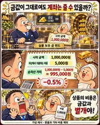 금 보유량과 비용</a></td></tr>
<tr><td valign="top"><a href="../trusta/106.webp">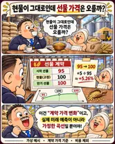 저가 선물 수렴</a></td><td valign="top"><a href="../trusta/107.webp">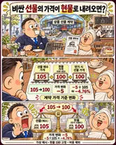 고가 선물 수렴</a></td><td valign="top"><a href="../trusta/108.webp">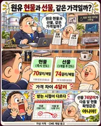 현물과 선물 가격</a></td><td valign="top"><a href="../trusta/109.webp">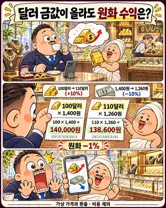 금의 원화환산</a></td><td valign="top"><a href="../trusta/110.webp">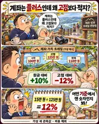 손익 기준점</a></td></tr>
<tr><td valign="top"><a href="../trusta/111.webp">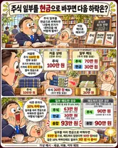 일부 매도후 위험</a></td><td valign="top"><a href="../trusta/112.webp">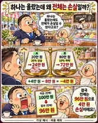 비중과 수익상쇄</a></td><td valign="top"><a href="../trusta/113.webp">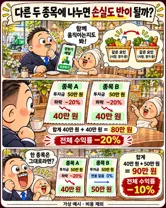 분산과 독립</a></td><td valign="top"><a href="../trusta/114.webp">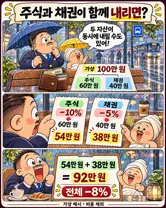 주식채권 동반하락</a></td><td valign="top"><a href="../trusta/115.webp">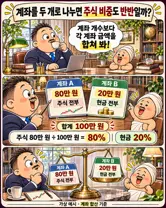 계좌 합산 비중</a></td></tr>
<tr><td valign="top"><a href="../trusta/116.webp">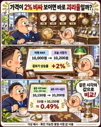 기준가 시각</a></td><td valign="top"><a href="../trusta/117.webp">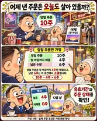 당일 주문과 만료</a></td><td valign="top"><a href="../trusta/118.webp">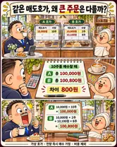 호가 수량의 깊이</a></td><td valign="top"><a href="../trusta/119.webp">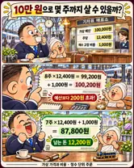 예산과 주문한도</a></td><td valign="top"><a href="../trusta/120.webp">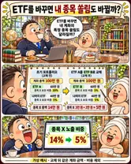 교체후 종목 겹침</a></td></tr>
<tr><td valign="top"><a href="../trusta/121.webp">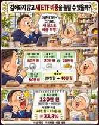 기존 자산과 새 납입금</a></td><td valign="top"><a href="../trusta/122.webp">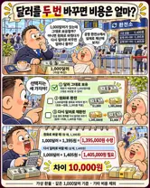 통화 교체비</a></td><td valign="top"><a href="../trusta/123.webp">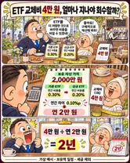 절감액 회수</a></td><td valign="top"><a href="../trusta/124.webp">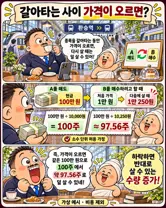 가격 공백</a></td><td valign="top"><a href="../trusta/125.webp">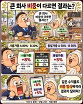 동일가중과 시총가중</a></td></tr>
<tr><td valign="top"><a href="../trusta/126.webp">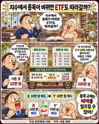 지수 교체 날</a></td><td valign="top"><a href="../trusta/127.webp">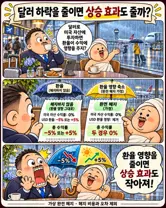 환율 완충 비교</a></td><td valign="top"><a href="../trusta/128.webp">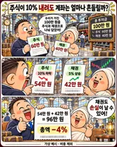 혼합형의 상쇄</a></td><td valign="top"><a href="../trusta/129.webp">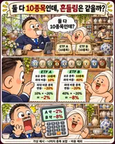 동일 종목수와 집중도</a></td><td valign="top"><a href="../trusta/130.webp">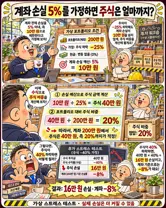 위험한도와 손실예산</a></td></tr>
<tr><td valign="top"><a href="../trusta/131.webp">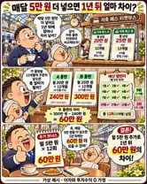 수익보다 저축액</a></td><td valign="top"><a href="../trusta/132.webp">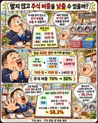 새 돈으로 비중 맞추기</a></td><td valign="top"><a href="../trusta/133.webp">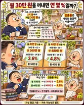 생활비 인출률</a></td><td valign="top"><a href="../trusta/134.webp">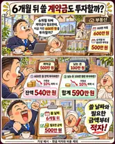 계약금 분리</a></td><td valign="top"><a href="../trusta/135.webp">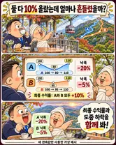 같은 종착점 다른 낙폭</a></td></tr>
<tr><td valign="top"><a href="../trusta/136.webp">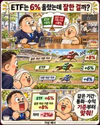 비교지수 선택</a></td><td valign="top"><a href="../trusta/137.webp">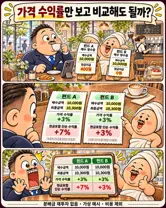 분배금 기준을 맞추기</a></td><td valign="top"><a href="../trusta/138.webp">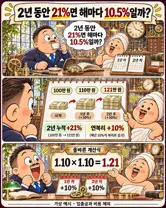 기간 환산</a></td><td valign="top"><a href="../trusta/139.webp">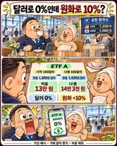 통화 기준</a></td><td valign="top"><a href="../trusta/140.webp">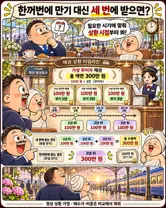 만기 나누기</a></td></tr>
<tr><td valign="top"><a href="../trusta/141.webp">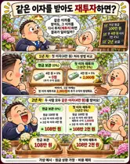 이자 재투자</a></td><td valign="top"><a href="../trusta/142.webp">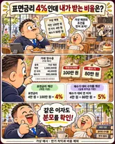 표면금리와 현금수익률</a></td><td valign="top"><a href="../trusta/143.webp">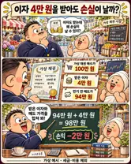 중도 매도</a></td><td valign="top"><a href="../trusta/144.webp">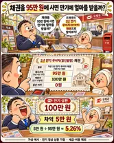 할인 매수</a></td><td valign="top"><a href="../trusta/145.webp">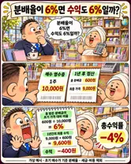 분배율과 총손익</a></td></tr>
<tr><td valign="top"><a href="../trusta/146.webp">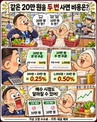 소액과 주문횟수</a></td><td valign="top"><a href="../trusta/147.webp">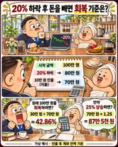 현금과 인출후 회복</a></td><td valign="top"><a href="../trusta/148.webp">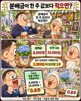 한주 재투자</a></td><td valign="top"><a href="../trusta/149.webp">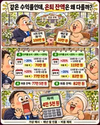 인출 순서</a></td><td valign="top"><a href="../trusta/150.webp">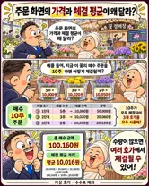 주문 평균 가격</a></td></tr>
</table>
