# TRUSTA 카드 · 151–200

[전체 목록](../README.md)

<table>
<tr><td valign="top"><a href="../trusta/151.webp">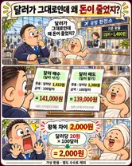 환전 왕복</a></td><td valign="top"><a href="../trusta/152.webp">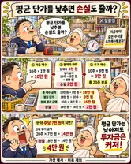 추가매수와 손실</a></td><td valign="top"><a href="../trusta/153.webp">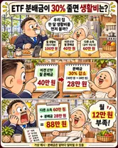 분배금 감소</a></td><td valign="top"><a href="../trusta/154.webp">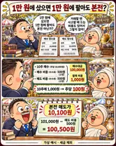 수수료와 본전</a></td><td valign="top"><a href="../trusta/155.webp">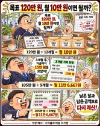 월납입과 목표액</a></td></tr>
<tr><td valign="top"><a href="../trusta/156.webp">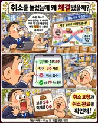 주문 취소 후 확인</a></td><td valign="top"><a href="../trusta/157.webp">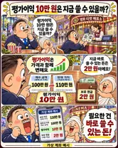 손익 확정과 현금</a></td><td valign="top"><a href="../trusta/158.webp">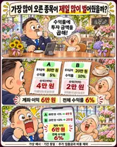 수익 기여</a></td><td valign="top"><a href="../trusta/159.webp">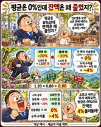 등락과 복리</a></td><td valign="top"><a href="../trusta/160.webp">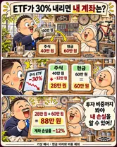 계좌 충격 비교</a></td></tr>
<tr><td valign="top"><a href="../trusta/161.webp"> 비용과 복리</a></td><td valign="top"><a href="../trusta/162.webp">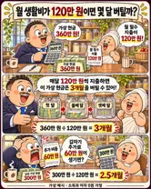 비상금 개월수</a></td><td valign="top"><a href="../trusta/163.webp">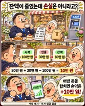 인출과 손익</a></td><td valign="top"><a href="../trusta/164.webp"> 입금과 수익</a></td><td valign="top"><a href="../trusta/165.webp">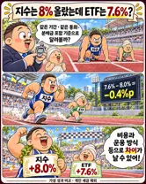 추적 차이</a></td></tr>
<tr><td valign="top"><a href="../trusta/166.webp">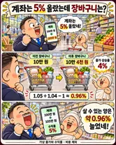 구매력 계산</a></td><td valign="top"><a href="../trusta/167.webp"> 부분 체결</a></td><td valign="top"><a href="../trusta/168.webp"> 최저 수수료</a></td><td valign="top"><a href="../trusta/169.webp"> 환전 우대</a></td><td valign="top"><a href="../trusta/170.webp">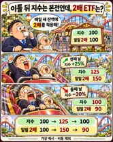 일일 두배</a></td></tr>
<tr><td valign="top"><a href="../trusta/171.webp"> 보유기간 비용</a></td><td valign="top"><a href="../trusta/172.webp"> 부분매도 실현손익</a></td><td valign="top"><a href="../trusta/173.webp"> 세후 손익 계산</a></td><td valign="top"><a href="../trusta/174.webp">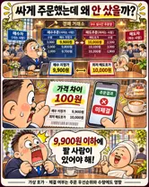 지정가 미체결</a></td><td valign="top"><a href="../trusta/175.webp">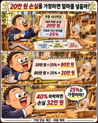 손실 가정에서 투자금</a></td></tr>
<tr><td valign="top"><a href="../trusta/176.webp"> 상승시 대기 비용</a></td><td valign="top"><a href="../trusta/177.webp">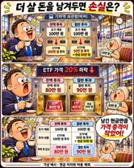 하락시 남는 현금</a></td><td valign="top"><a href="../trusta/178.webp"> 같은 돈 다른 수량</a></td><td valign="top"><a href="../trusta/179.webp"> 일곱 봉투</a></td><td valign="top"><a href="../trusta/180.webp">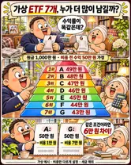 같은 수익률 실수익 TOP7</a></td></tr>
<tr><td valign="top"><a href="../trusta/181.webp">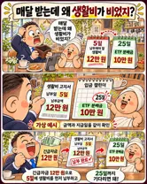 지급일</a></td><td valign="top"><a href="../trusta/182.webp">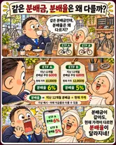 분배율</a></td><td valign="top"><a href="../trusta/183.webp">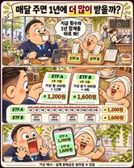 지급 빈도</a></td><td valign="top"><a href="../trusta/184.webp"> 채권 이자</a></td><td valign="top"><a href="../trusta/185.webp"> 배당금과 분배금</a></td></tr>
<tr><td valign="top"><a href="../trusta/186.webp">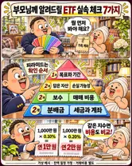 부모님께 알려드릴 ETF 실속 체크 7가지</a></td><td valign="top"><a href="../trusta/187.webp">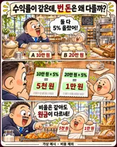 수익률</a></td><td valign="top"><a href="../trusta/188.webp"> 재투자</a></td><td valign="top"><a href="../trusta/189.webp"> 괴리율</a></td><td valign="top"><a href="../trusta/190.webp"> 결제일</a></td></tr>
<tr><td valign="top"><a href="../trusta/191.webp">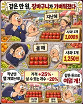 사과</a></td><td valign="top"><a href="../trusta/192.webp"> 같은 지수 다른 비용</a></td><td valign="top"><a href="../trusta/193.webp">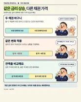 듀레이션 민감도</a></td><td valign="top"><a href="../trusta/194.webp">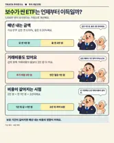 비용 손익분기</a></td><td valign="top"><a href="../trusta/195.webp">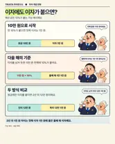 복리의 기준금액</a></td></tr>
<tr><td valign="top"><a href="../trusta/196.webp">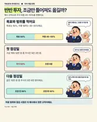 허용범위 비중조정</a></td><td valign="top"><a href="../trusta/197.webp">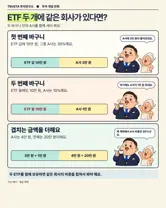 겹치는 종목</a></td><td valign="top"><a href="../trusta/198.webp">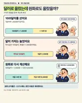 환율이 바꾼 손익</a></td><td valign="top"><a href="../trusta/199.webp">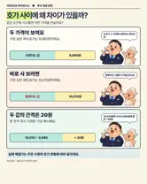 매수호가와 매도호가</a></td><td valign="top"><a href="../trusta/200.webp">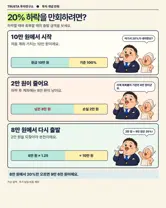 손실을 회복하는 비율</a></td></tr>
</table>
