# TRUSTA 카드 · 201–250

[전체 목록](../README.md)

<table>
<tr><td valign="top"><a href="../trusta/201.webp">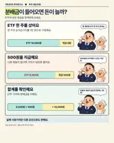 분배금과 계좌가치</a></td><td valign="top"><a href="../trusta/202.webp"> 납입금으로 비중 맞추기</a></td><td valign="top"><a href="../trusta/203.webp"> 반반 투자로 되돌리기</a></td><td valign="top"><a href="../trusta/204.webp"> 세 지수 성과차이 2018</a></td><td valign="top"><a href="../trusta/205.webp">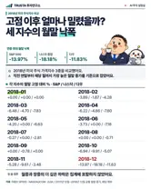 세 지수 고점대비 2018</a></td></tr>
<tr><td valign="top"><a href="../trusta/206.webp">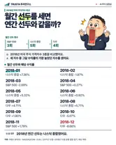 세 지수 월간 선두 2018</a></td><td valign="top"><a href="../trusta/207.webp"> 세 지수 누적 2018</a></td><td valign="top"><a href="../trusta/208.webp"> 세 지수 월간 2018</a></td><td valign="top"><a href="../trusta/209.webp">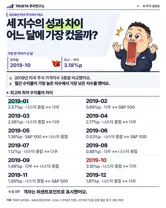 세 지수 성과차이 2019</a></td><td valign="top"><a href="../trusta/210.webp">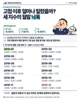 세 지수 고점대비 2019</a></td></tr>
<tr><td valign="top"><a href="../trusta/211.webp">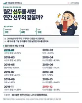 세 지수 월간 선두 2019</a></td><td valign="top"><a href="../trusta/212.webp">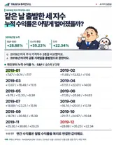 세 지수 누적 2019</a></td><td valign="top"><a href="../trusta/213.webp">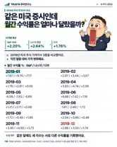 세 지수 월간 2019</a></td><td valign="top"><a href="../trusta/214.webp">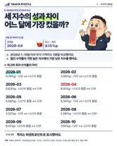 세 지수 성과차이 2026</a></td><td valign="top"><a href="../trusta/215.webp">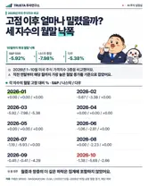 세 지수 고점대비 2026</a></td></tr>
<tr><td valign="top"><a href="../trusta/216.webp">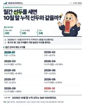 세 지수 월간 선두 2026</a></td><td valign="top"><a href="../trusta/217.webp">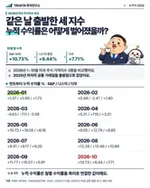 세 지수 누적 2026</a></td><td valign="top"><a href="../trusta/218.webp">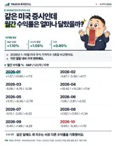 세 지수 월간 2026</a></td><td valign="top"><a href="../trusta/219.webp">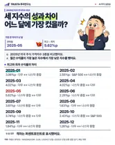 세 지수 성과차이 2025</a></td><td valign="top"><a href="../trusta/220.webp">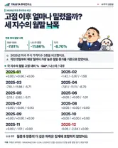 세 지수 고점대비 2025</a></td></tr>
<tr><td valign="top"><a href="../trusta/221.webp">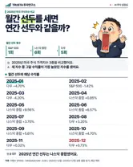 세 지수 월간 선두 2025</a></td><td valign="top"><a href="../trusta/222.webp">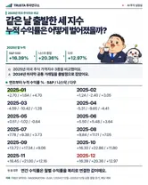 세 지수 누적 2025</a></td><td valign="top"><a href="../trusta/223.webp"> 세 지수 월간 2025</a></td><td valign="top"><a href="../trusta/224.webp">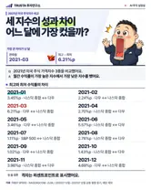 세 지수 성과차이 2021</a></td><td valign="top"><a href="../trusta/225.webp">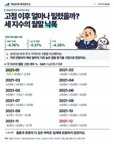 세 지수 고점대비 2021</a></td></tr>
<tr><td valign="top"><a href="../trusta/226.webp">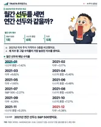 세 지수 월간 선두 2021</a></td><td valign="top"><a href="../trusta/227.webp">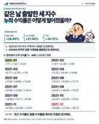 세 지수 누적 2021</a></td><td valign="top"><a href="../trusta/228.webp"> 세 지수 월간 2021</a></td><td valign="top"><a href="../trusta/229.webp"> 세 지수 성과차이 2020</a></td><td valign="top"><a href="../trusta/230.webp">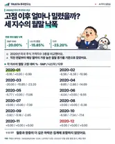 세 지수 고점대비 2020</a></td></tr>
<tr><td valign="top"><a href="../trusta/231.webp"> 세 지수 월간 선두 2020</a></td><td valign="top"><a href="../trusta/232.webp">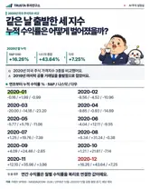 세 지수 누적 2020</a></td><td valign="top"><a href="../trusta/233.webp"> 세 지수 월간 2020</a></td><td valign="top"><a href="../trusta/234.webp">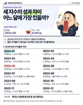 세 지수 성과차이 2023</a></td><td valign="top"><a href="../trusta/235.webp">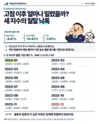 세 지수 고점대비 2023</a></td></tr>
<tr><td valign="top"><a href="../trusta/236.webp"> 세 지수 월간 선두 2023</a></td><td valign="top"><a href="../trusta/237.webp"> 세 지수 누적 2023</a></td><td valign="top"><a href="../trusta/238.webp"> 세 지수 월간 2023</a></td><td valign="top"><a href="../trusta/239.webp">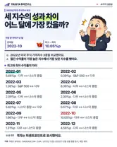 세 지수 성과차이 2022</a></td><td valign="top"><a href="../trusta/240.webp">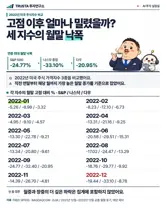 세 지수 고점대비 2022</a></td></tr>
<tr><td valign="top"><a href="../trusta/241.webp">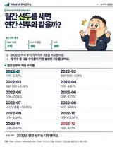 세 지수 월간 선두 2022</a></td><td valign="top"><a href="../trusta/242.webp">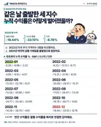 세 지수 누적 2022</a></td><td valign="top"><a href="../trusta/243.webp">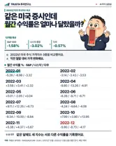 세 지수 월간 2022</a></td><td valign="top"><a href="../trusta/244.webp">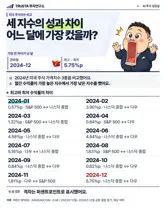 세 지수 성과차이</a></td><td valign="top"><a href="../trusta/245.webp">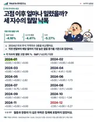 세 지수 고점대비</a></td></tr>
<tr><td valign="top"><a href="../trusta/246.webp">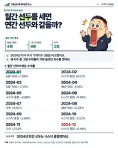 세 지수 월간 선두</a></td><td valign="top"><a href="../trusta/247.webp">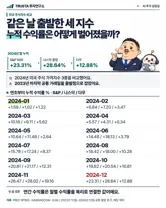 세 지수 누적</a></td><td valign="top"><a href="../trusta/248.webp"> 세 지수 월간</a></td><td valign="top"><a href="../trusta/249.webp">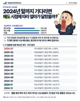 2024년 월말 매도 시나리오</a></td><td valign="top"><a href="../trusta/250.webp">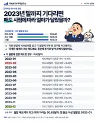 2023년 월말 매도 시나리오</a></td></tr>
</table>
