# TRUSTA 카드 · 251–300

[전체 목록](../README.md)

<table>
<tr><td valign="top"><a href="../trusta/251.webp">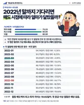 2022년 월말 매도 시나리오</a></td><td valign="top"><a href="../trusta/252.webp">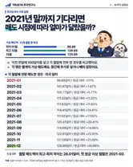 2021년 월말 매도 시나리오</a></td><td valign="top"><a href="../trusta/253.webp"> 2020년 월말 매도 시나리오</a></td><td valign="top"><a href="../trusta/254.webp">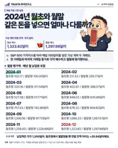 2024년 월초와 월말 적립</a></td><td valign="top"><a href="../trusta/255.webp">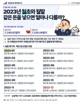 2023년 월초와 월말 적립</a></td></tr>
<tr><td valign="top"><a href="../trusta/256.webp"> 2022년 월초와 월말 적립</a></td><td valign="top"><a href="../trusta/257.webp">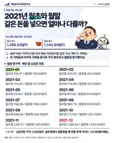 2021년 월초와 월말 적립</a></td><td valign="top"><a href="../trusta/258.webp"> 2020년 월초와 월말 적립</a></td><td valign="top"><a href="../trusta/259.webp">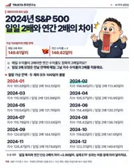 2024년 일일 두배 복리</a></td><td valign="top"><a href="../trusta/260.webp">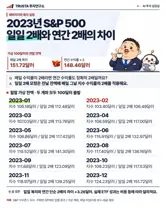 2023년 일일 두배 복리</a></td></tr>
<tr><td valign="top"><a href="../trusta/261.webp">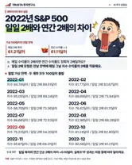 2022년 일일 두배 복리</a></td><td valign="top"><a href="../trusta/262.webp">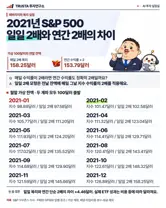 2021년 일일 두배 복리</a></td><td valign="top"><a href="../trusta/263.webp">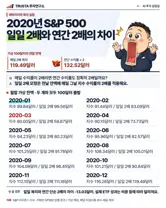 2020년 일일 두배 복리</a></td><td valign="top"><a href="../trusta/264.webp">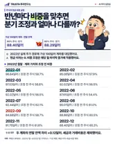 반기 비중복원</a></td><td valign="top"><a href="../trusta/265.webp">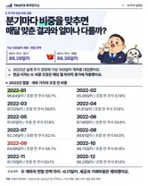 분기 비중복원</a></td></tr>
<tr><td valign="top"><a href="../trusta/266.webp">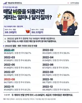 월말 비중복원</a></td><td valign="top"><a href="../trusta/267.webp">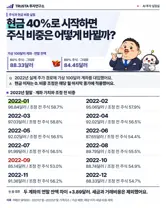 현금40 보유</a></td><td valign="top"><a href="../trusta/268.webp">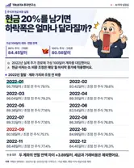 현금20 보유</a></td><td valign="top"><a href="../trusta/269.webp">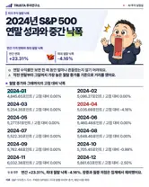 2024년 월말 고점대비 낙폭</a></td><td valign="top"><a href="../trusta/270.webp">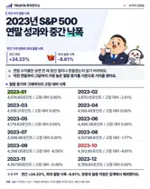 2023년 월말 고점대비 낙폭</a></td></tr>
<tr><td valign="top"><a href="../trusta/271.webp">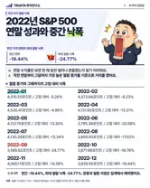 2022년 월말 고점대비 낙폭</a></td><td valign="top"><a href="../trusta/272.webp">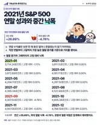 2021년 월말 고점대비 낙폭</a></td><td valign="top"><a href="../trusta/273.webp">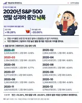 2020년 월말 고점대비 낙폭</a></td><td valign="top"><a href="../trusta/274.webp">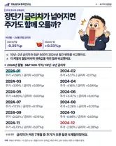 장단기차와 주가</a></td><td valign="top"><a href="../trusta/275.webp">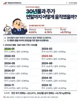 삼십년물과 주식</a></td></tr>
<tr><td valign="top"><a href="../trusta/276.webp">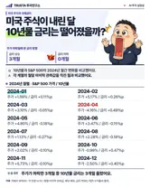 십년물과 주식 하락</a></td><td valign="top"><a href="../trusta/277.webp">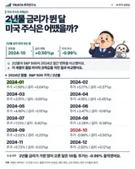 이년물과 주가</a></td><td valign="top"><a href="../trusta/278.webp">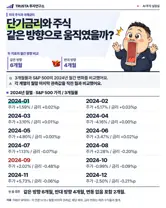 단기금리와 주가</a></td><td valign="top"><a href="../trusta/279.webp">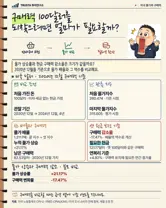 구매력과 원금회복</a></td><td valign="top"><a href="../trusta/280.webp">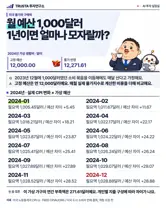 달마다 다른 생활비</a></td></tr>
<tr><td valign="top"><a href="../trusta/281.webp">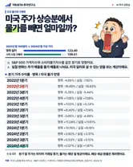 실질 분기 지수성과</a></td><td valign="top"><a href="../trusta/282.webp">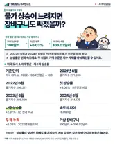 물가 속도와 가격 수준</a></td><td valign="top"><a href="../trusta/283.webp">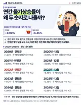 연평균과 연말 물가</a></td><td valign="top"><a href="../trusta/284.webp">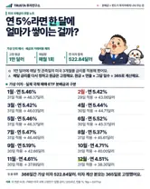 연율과 월 이자 모형</a></td><td valign="top"><a href="../trusta/285.webp">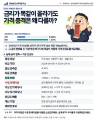 금리충격과 듀레이션</a></td></tr>
<tr><td valign="top"><a href="../trusta/286.webp">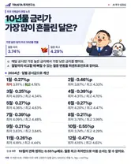 월별 십년물 금리범위</a></td><td valign="top"><a href="../trusta/287.webp">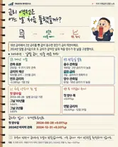 장단기 금리차 역전</a></td><td valign="top"><a href="../trusta/288.webp">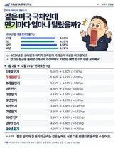 열한 만기 금리곡선</a></td><td valign="top"><a href="../trusta/289.webp">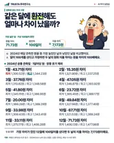 월중 환율 변동폭</a></td><td valign="top"><a href="../trusta/290.webp">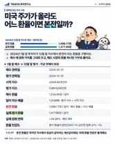 손익분기 환율</a></td></tr>
<tr><td valign="top"><a href="../trusta/291.webp">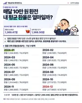 열두 번 환전한 평균단가</a></td><td valign="top"><a href="../trusta/292.webp">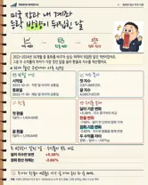 월간 수익률 부호 반전</a></td><td valign="top"><a href="../trusta/293.webp">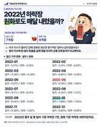 하락장 달러와 원화</a></td><td valign="top"><a href="../trusta/294.webp">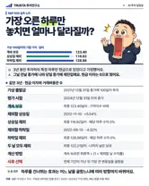 하루를 비운 세 해</a></td><td valign="top"><a href="../trusta/295.webp">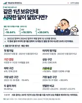 일년 보유 시작월</a></td></tr>
<tr><td valign="top"><a href="../trusta/296.webp">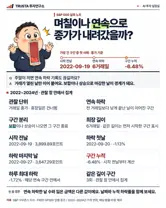 연속 하락의 길이</a></td><td valign="top"><a href="../trusta/297.webp">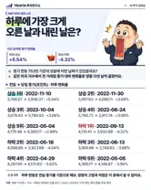 상승일과 하락일 양끝</a></td><td valign="top"><a href="../trusta/298.webp">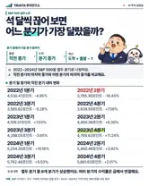 열두 분기의 수익률</a></td><td valign="top"><a href="../trusta/299.webp">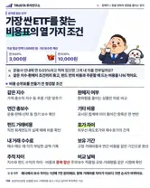 ETF 비용 비교의 열 조건</a></td><td valign="top"><a href="../trusta/300.webp">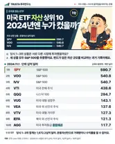 미국 ETF 자산 과거 순위</a></td></tr>
</table>
