# TRUSTA 카드 · 301–350

[전체 목록](../README.md)

<table>
<tr><td valign="top"><a href="../trusta/301.webp">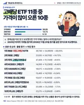 국내 고배당 가격수익률</a></td><td valign="top"><a href="../trusta/302.webp">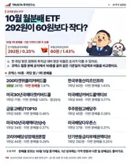 월분배 ETF 열 종목</a></td><td valign="top"><a href="../trusta/303.webp">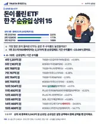 국내 ETF 주간 순유입 15</a></td><td valign="top"><a href="../trusta/304.webp">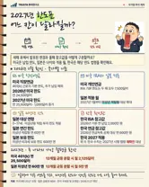 2027 절세계좌 달력</a></td><td valign="top"><a href="../trusta/305.webp">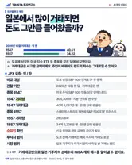 일본 ETF 거래대금과 순유입</a></td></tr>
<tr><td valign="top"><a href="../trusta/306.webp">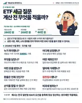 ETF 세금 질문 열 가지</a></td><td valign="top"><a href="../trusta/307.webp">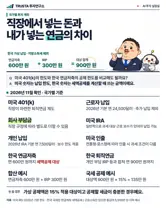 직장연금과 개인연금</a></td><td valign="top"><a href="../trusta/308.webp">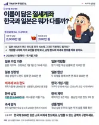 한국 ISA와 일본 NISA</a></td><td valign="top"><a href="../trusta/309.webp">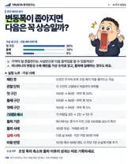 변동폭이 좁아지는 세 구간</a></td><td valign="top"><a href="../trusta/310.webp">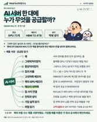 AI 서버 공급망</a></td></tr>
<tr><td valign="top"><a href="../trusta/311.webp">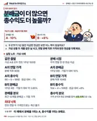 분배율과 총수익 순위</a></td><td valign="top"><a href="../trusta/312.webp">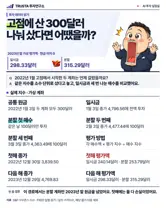 고점에서 시작한 두 계좌</a></td><td valign="top"><a href="../trusta/313.webp">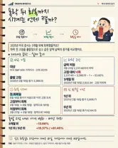 코로나 급락 회복 시계</a></td><td valign="top"><a href="../trusta/314.webp">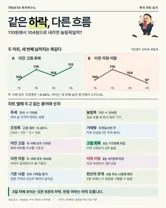 같은 하락 다른 흐름</a></td><td valign="top"><a href="../trusta/315.webp">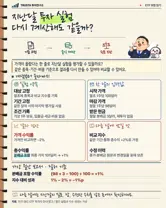 월간 투자연구 성적표</a></td></tr>
<tr><td valign="top"><a href="../trusta/316.webp">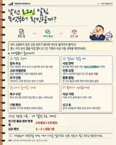 계좌 보안 점검</a></td><td valign="top"><a href="../trusta/317.webp">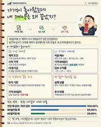 증거금과 강제청산</a></td><td valign="top"><a href="../trusta/318.webp">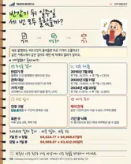 반감기 전후 일주일</a></td><td valign="top"><a href="../trusta/319.webp">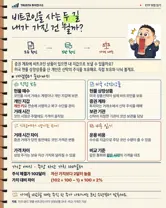 비트코인과 상장상품</a></td><td valign="top"><a href="../trusta/320.webp">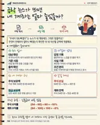 급락장 뉴스와 내 계좌</a></td></tr>
<tr><td valign="top"><a href="../trusta/321.webp">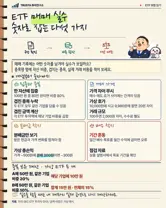 매매 실수 다섯 가지</a></td><td valign="top"><a href="../trusta/322.webp">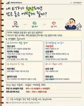 ETF 청산과 내 돈</a></td><td valign="top"><a href="../trusta/323.webp">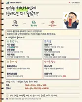 인버스 이틀 계산</a></td><td valign="top"><a href="../trusta/324.webp">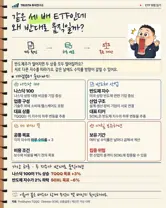 반도체와 나스닥 세배</a></td><td valign="top"><a href="../trusta/325.webp">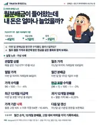 월분배 성과표</a></td></tr>
<tr><td valign="top"><a href="../trusta/326.webp">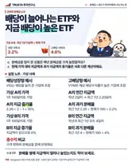 배당성장과 고배당</a></td><td valign="top"><a href="../trusta/327.webp">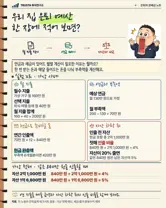 은퇴 예산 설계</a></td><td valign="top"><a href="../trusta/328.webp">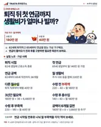 연금 전후 생활비</a></td><td valign="top"><a href="../trusta/329.webp">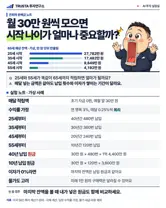 적립기간과 은퇴잔액</a></td><td valign="top"><a href="../trusta/330.webp">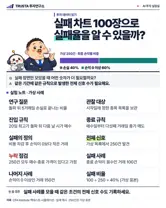 실패차트 표본설계</a></td></tr>
<tr><td valign="top"><a href="../trusta/331.webp">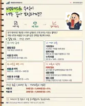 백테스트 착시</a></td><td valign="top"><a href="../trusta/332.webp">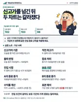 신고가 돌파 두 경로</a></td><td valign="top"><a href="../trusta/333.webp">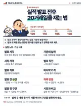 발표 전후 20거래일</a></td><td valign="top"><a href="../trusta/334.webp">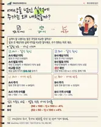 실적과 주가 두 사례</a></td><td valign="top"><a href="../trusta/335.webp">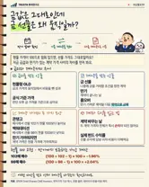 금 현물과 선물 한눈에</a></td></tr>
<tr><td valign="top"><a href="../trusta/336.webp">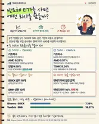 반도체 ETF 한눈에</a></td><td valign="top"><a href="../trusta/337.webp">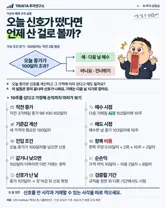 투자전략 판단 흐름도</a></td><td valign="top"><a href="../trusta/338.webp">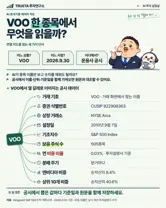 VOO 공시 연결지도</a></td><td valign="top"><a href="../trusta/339.webp">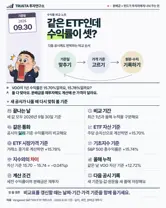 ETF 수익률 비교 순환도</a></td><td valign="top"><a href="../trusta/340.webp">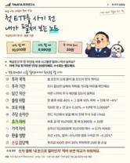 첫 ETF 손글씨 노트</a></td></tr>
<tr><td valign="top"><a href="../trusta/341.webp">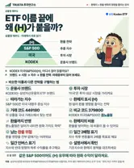 ETF 이름 피라미드</a></td><td valign="top"><a href="../trusta/342.webp">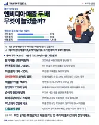 엔비디아 실적 한장 요약</a></td><td valign="top"><a href="../trusta/343.webp">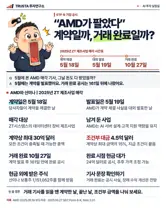 AMD 매각 발표와 거래완료</a></td><td valign="top"><a href="../trusta/344.webp">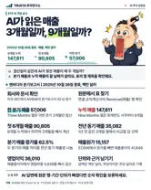 엔비디아 공시 AI 검산</a></td><td valign="top"><a href="../trusta/345.webp">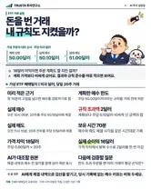 AI로 매매일지 검산</a></td></tr>
<tr><td valign="top"><a href="../trusta/346.webp">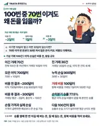 승률과 거래당 기대값</a></td><td valign="top"><a href="../trusta/347.webp">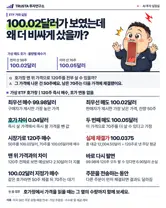 호가창과 실제 체결가</a></td><td valign="top"><a href="../trusta/348.webp">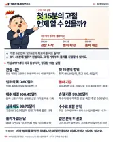 개장 첫 15분 돌파</a></td><td valign="top"><a href="../trusta/349.webp">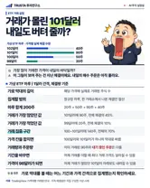 가격별 거래량 읽기</a></td><td valign="top"><a href="../trusta/350.webp">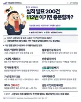 실적 200건 연구 설계</a></td></tr>
</table>
