# TRUSTA 카드 · 351–400

[전체 목록](../README.md)

<table>
<tr><td valign="top"><a href="../trusta/351.webp">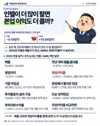 인텔과 AMD 같은 결산일</a></td><td valign="top"><a href="../trusta/352.webp">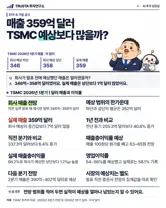 TSMC 회사 전망과 실적</a></td><td valign="top"><a href="../trusta/353.webp">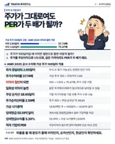 이익과 장부가와 현금</a></td><td valign="top"><a href="../trusta/354.webp">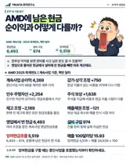 이익에서 잉여현금까지</a></td><td valign="top"><a href="../trusta/355.webp">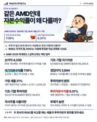 주주자본과 투하자본</a></td></tr>
<tr><td valign="top"><a href="../trusta/356.webp">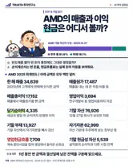 재무제표 세 장</a></td><td valign="top"><a href="../trusta/357.webp">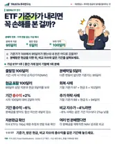 분배락과 NAV 하락</a></td><td valign="top"><a href="../trusta/358.webp">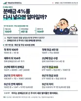 분배금 재투자</a></td><td valign="top"><a href="../trusta/359.webp">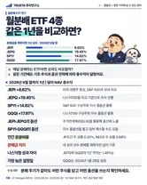 월분배 ETF 네종 비교</a></td><td valign="top"><a href="../trusta/360.webp">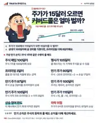 커버드콜의 만기손익</a></td></tr>
<tr><td valign="top"><a href="../trusta/361.webp">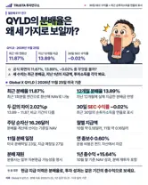 QYLD 분배율 읽기</a></td><td valign="top"><a href="../trusta/362.webp">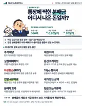 분배금의 재원</a></td><td valign="top"><a href="../trusta/363.webp">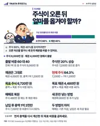 자산배분 리밸런싱</a></td><td valign="top"><a href="../trusta/364.webp">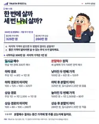 적립식과 일시금</a></td><td valign="top"><a href="../trusta/365.webp">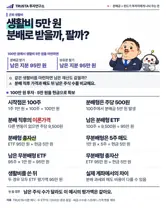 분배금과 정액매도</a></td></tr>
<tr><td valign="top"><a href="../trusta/366.webp">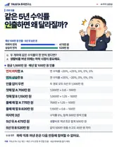 은퇴 인출 순서</a></td><td valign="top"><a href="../trusta/367.webp">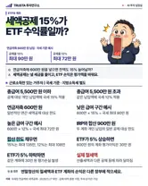 세액공제와 운용손익</a></td><td valign="top"><a href="../trusta/368.webp">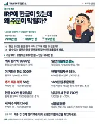 IRP 위험자산 주문여력</a></td><td valign="top"><a href="../trusta/369.webp">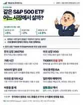 국내상장과 미국직상장</a></td><td valign="top"><a href="../trusta/370.webp">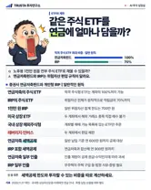 연금저축과 IRP의 ETF</a></td></tr>
<tr><td valign="top"><a href="../trusta/371.webp">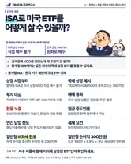 ISA에서 살 수 있는 ETF</a></td><td valign="top"><a href="../trusta/372.webp">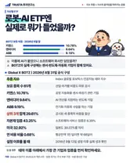 로봇테마 구성종목</a></td><td valign="top"><a href="../trusta/373.webp">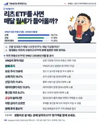 리츠ETF 분배와가격</a></td><td valign="top"><a href="../trusta/374.webp">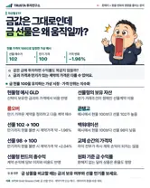 금현물과 금선물</a></td><td valign="top"><a href="../trusta/375.webp">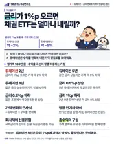 채권ETF 듀레이션</a></td></tr>
<tr><td valign="top"><a href="../trusta/376.webp">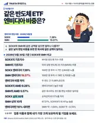 반도체 집중도</a></td><td valign="top"><a href="../trusta/377.webp">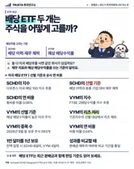 SCHD와 VYM</a></td><td valign="top"><a href="../trusta/378.webp">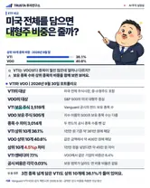 VTI와 VOO</a></td><td valign="top"><a href="../trusta/379.webp">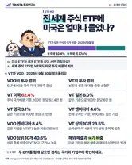 미국주식과 전세계주식</a></td><td valign="top"><a href="../trusta/380.webp">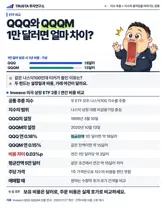 QQQ와 QQQM</a></td></tr>
<tr><td valign="top"><a href="../trusta/381.webp">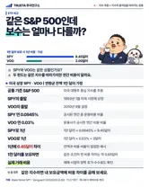 S&amp;P500 두 ETF</a></td><td valign="top"><a href="../trusta/382.webp">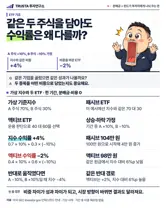 패시브와 액티브</a></td><td valign="top"><a href="../trusta/383.webp">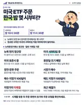 미국ETF 주문과 시간</a></td><td valign="top"><a href="../trusta/384.webp">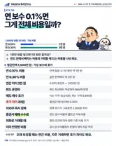 보수와 거래비용</a></td><td valign="top"><a href="../trusta/385.webp">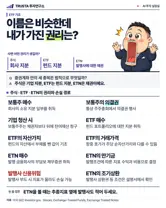 주식 ETF ETN</a></td></tr>
<tr><td valign="top"><a href="../trusta/386.webp">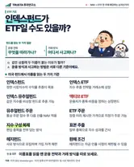 펀드의 분류</a></td><td valign="top"><a href="../trusta/387.webp">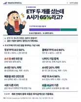 겹치는 종목</a></td><td valign="top"><a href="../trusta/388.webp">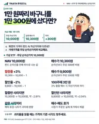 시장가격과 NAV</a></td><td valign="top"><a href="../trusta/389.webp">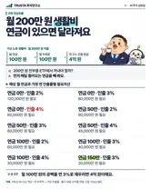 생활비와 필요자산</a></td><td valign="top"><a href="../trusta/390.webp">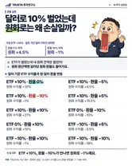 달러수익과 환율</a></td></tr>
<tr><td valign="top"><a href="../trusta/391.webp">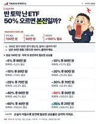 하락률과 회복률</a></td><td valign="top"><a href="../trusta/392.webp">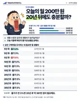 물가와 생활비</a></td><td valign="top"><a href="../trusta/393.webp">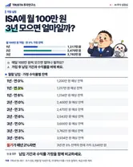 월납 3년</a></td><td valign="top"><a href="../trusta/394.webp">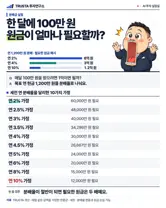 월100만원 필요원금</a></td><td valign="top"><a href="../trusta/395.webp">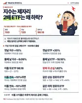 레버리지 일일복리</a></td></tr>
<tr><td valign="top"><a href="../trusta/396.webp">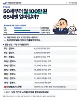 월납 15년</a></td><td valign="top"><a href="../trusta/397.webp">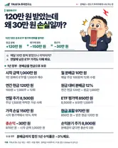 분배금과 총손익</a></td><td valign="top"><a href="../trusta/398.webp">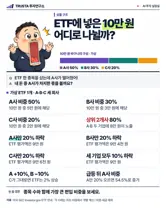 10만원의 편입비중</a></td><td valign="top"><a href="../trusta/399.webp">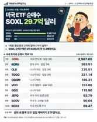 미국 ETF 순매수</a></td><td valign="top"><a href="../trusta/400.webp">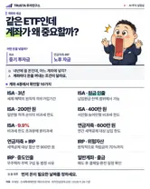 계좌 4종</a></td></tr>
</table>
